# Sơ đồ triển khai thực tế — SQLite schema 11

Các sơ đồ mô tả bản một thiết bị. Tác nhân khách/admin lần lượt dùng auth_session; đơn hàng dùng SQLite cục bộ; Firebase chỉ được bật ở biến thể phù hợp cho ưu đãi và FCM. Có SVG ngoại tuyến kèm từng sơ đồ để in/xem không cần thư viện Mermaid.

## 1. Use case

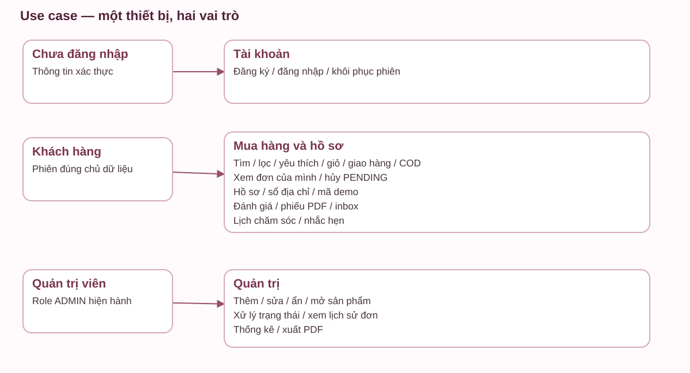

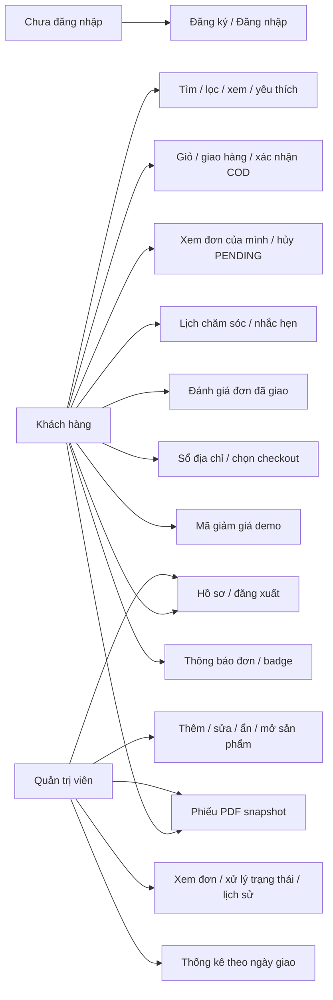

## 2. Kiến trúc

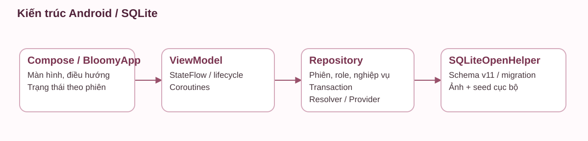

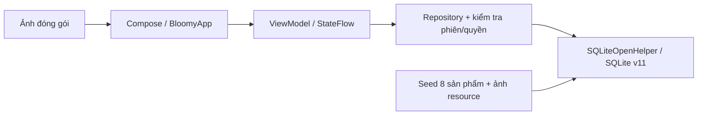

AuthViewModel sở hữu ViewModelStore của phiên; store giữ qua cấu hình và xóa sau đăng xuất thành công. Repository dùng Dispatchers.IO và transaction. Biểu mẫu hồ sơ không tự tải đè khi resume.

## 3. Quan hệ dữ liệu

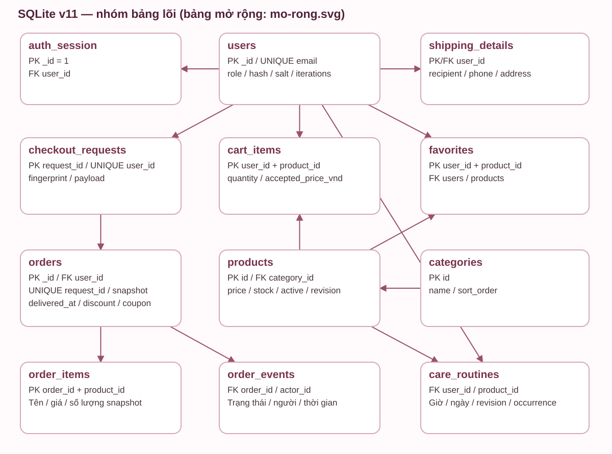

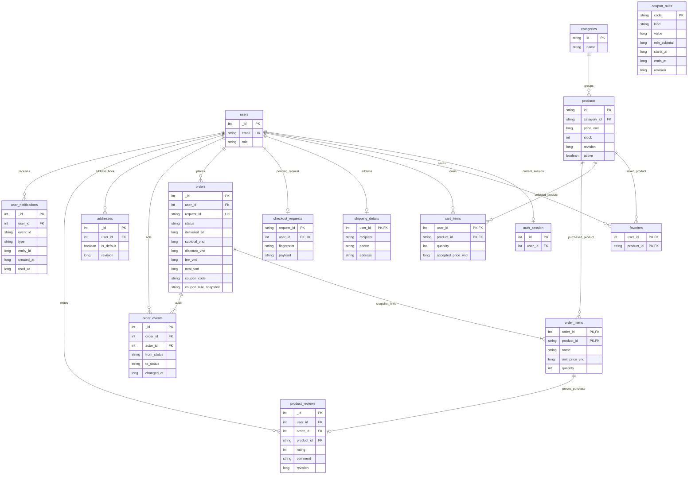

`orders.request_id` liên hệ logic với request đã tạo; không khai báo FK tới checkout_requests vì yêu cầu có thể được acknowledge/xóa sau khi khách xem kết quả. `order_items.product_id` có FK tới products nhưng tên/giá/dung tích/ảnh lưu snapshot. SVG chỉ vẽ các đường chính cho dễ đọc; Mermaid trên liệt kê cả quan hệ phụ.

Các bảng mở rộng có sơ đồ riêng: 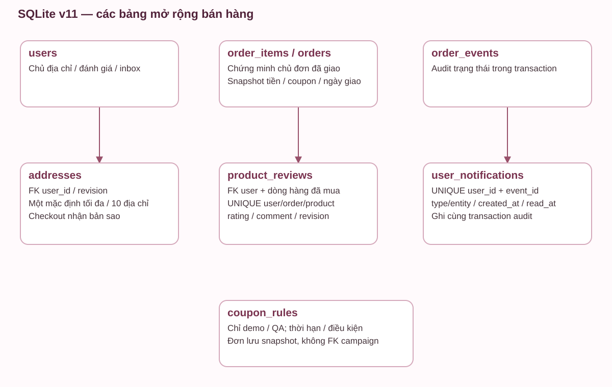. `user_notifications.entity_id` là đích logic không có FK tới orders để giữ lịch sử khi đích không còn; event_id dẫn từ audit, không chứa PII. `coupon_rules` không có FK từ đơn vì đơn lưu snapshot và không mất theo chiến dịch.

## 4. Trình tự đặt COD

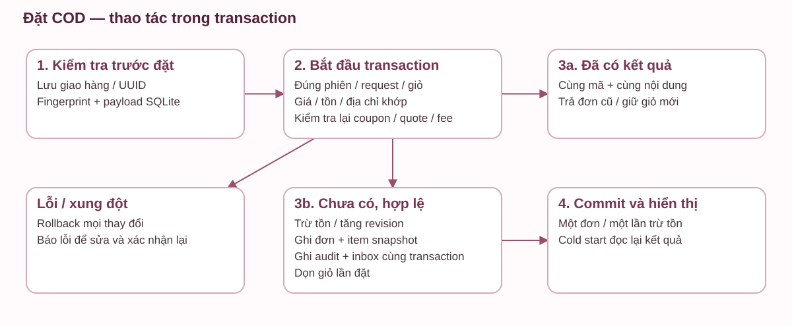

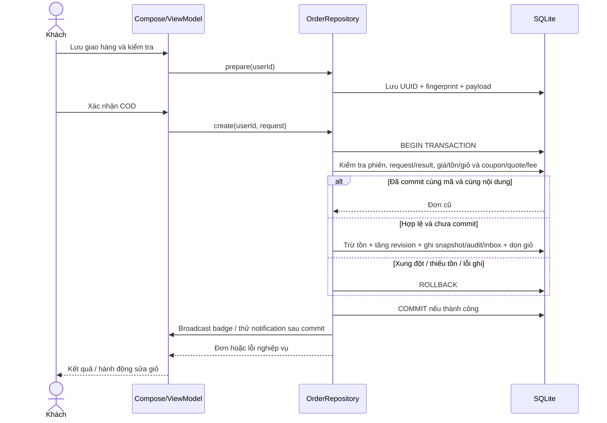

Không tra kết quả bằng mạng; khôi phục dùng request đã lưu trên cùng database. Replay thành công không dọn giỏ vừa thêm lần nữa.

## 5. Hủy và trạng thái

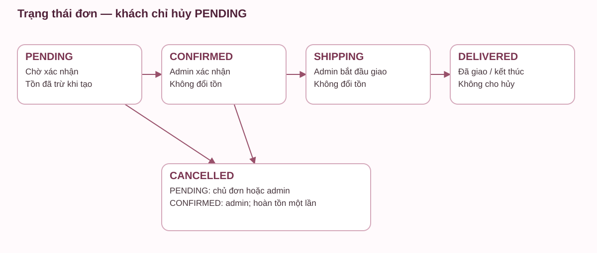

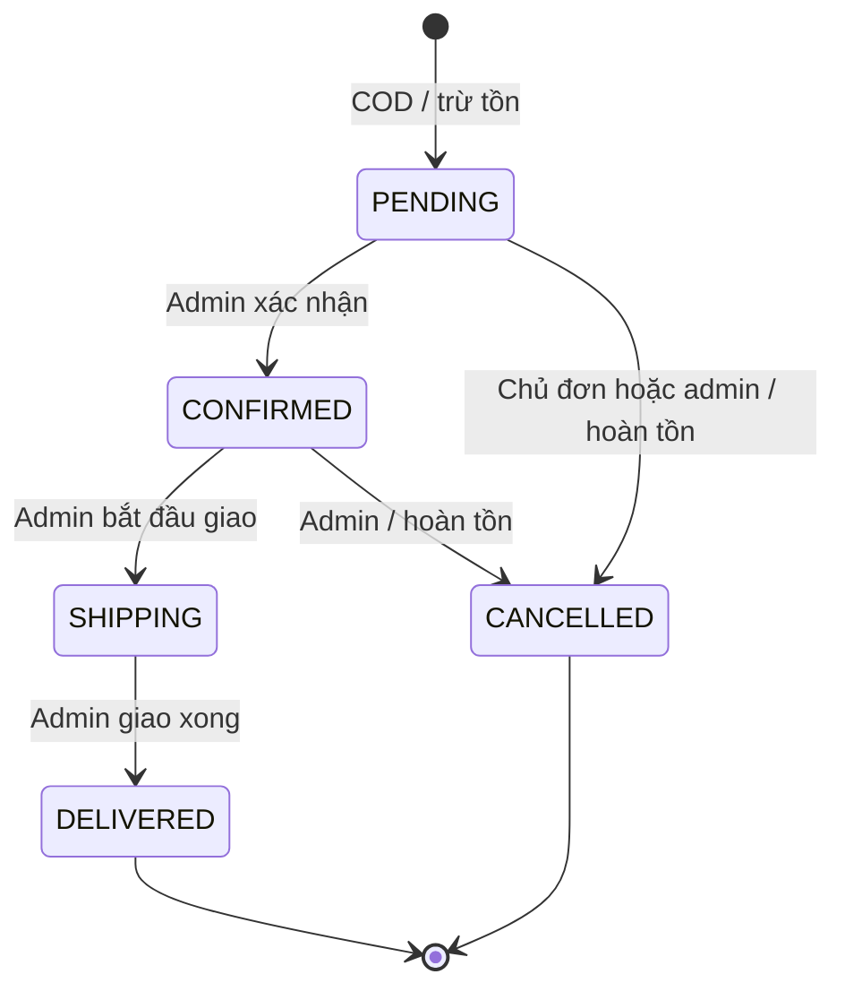

Hủy kiểm tra phiên, quyền sở hữu/vai trò và trạng thái trong transaction; cập nhật trạng thái có điều kiện, hoàn tồn từng dòng, tăng revision và ghi audit. Gửi lại hủy đã thành công không hoàn tồn lần hai. Khi lỗi ghi lịch sử hoặc tràn tồn, rollback cả trạng thái và tồn. Khách không hủy CONFIRMED/SHIPPING/DELIVERED.

## 6. Lịch chăm sóc bổ sung ở schema 6

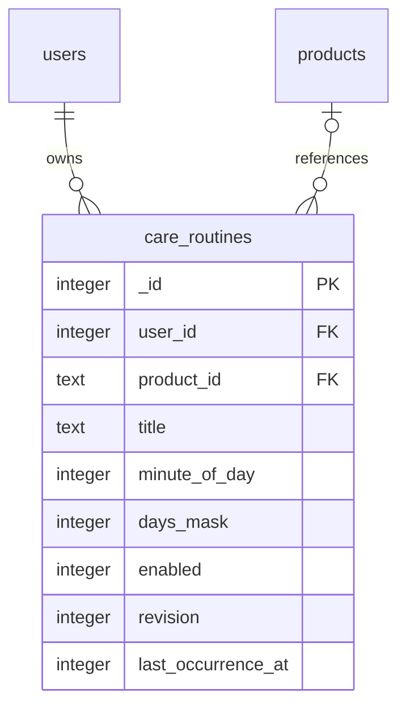

UI → ViewModel → Repository → ContentResolver → CareRoutineProvider → SQLite.
ContentObserver cập nhật danh sách sau commit. AlarmManager → receiver tĩnh → kiểm tra phiên/revision/occurrence → notification. Receiver hệ thống khôi phục lịch; receiver động nhận tín hiệu đổi đơn theo vòng đời.

## 7. Tham khảo tùy chọn: danh tính Cloud B0/B1

Phần này lưu thử nghiệm đã làm; không cần triển khai backend hoặc chạy Cloud để hoàn thành demo môn học.

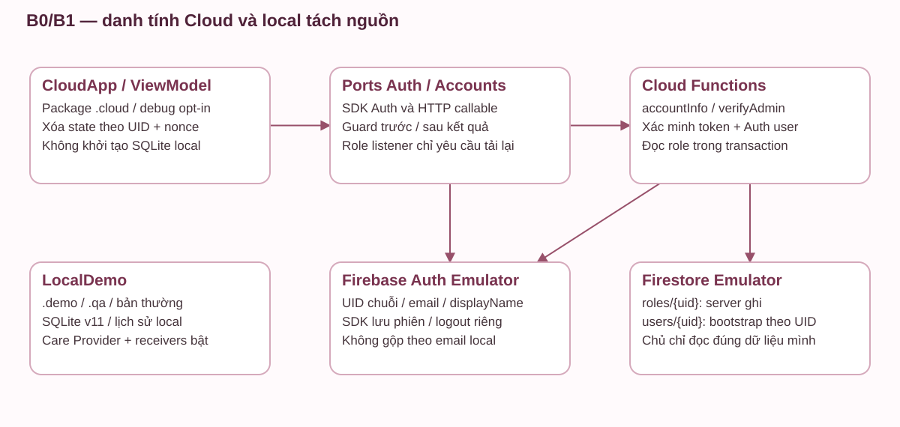

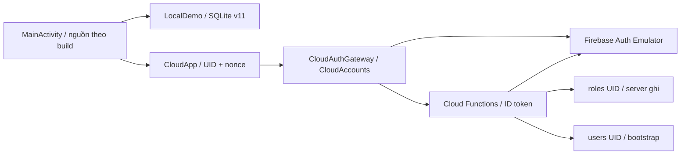

Cloud dùng package `.cloud` và project `demo-bloomy-commerce`; bản thường/demo/QA còn LocalDemo. UID và token Firebase không lấy từ auth_session hoặc users.role SQLite. Callback phiên cũ bị loại; profile/role Cloud chỉ được đọc đúng chủ qua rules. B2/B3 mới thêm giao dịch và đồng bộ nghiệp vụ; sơ đồ này không mô tả chúng như đã triển khai.
