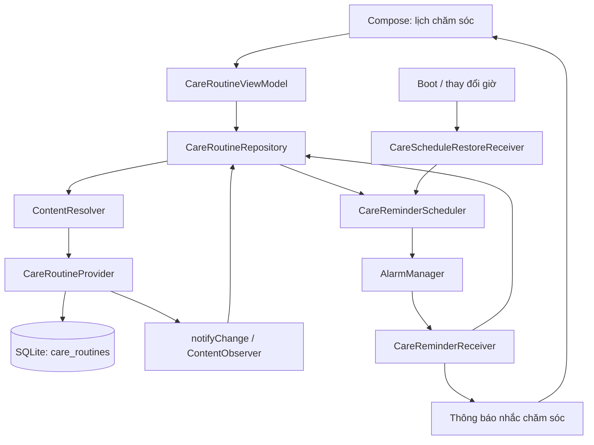

# Kế hoạch bổ sung Content Provider và Broadcast Receiver

Ngày lập: 07/11/2026. Cập nhật: F1–F3 đã được triển khai; xem kết quả và giới hạn nghiệm thu ở mục 12. F4 còn là phần mở rộng.

Đề xuất làm **lịch chăm sóc da cá nhân có nhắc hẹn**, sau đó bổ sung **cập nhật màn hình khi đơn hàng thay đổi**. Hai phần này tạo được luồng demo có ích cho Bloomy Beauty và minh họa trực tiếp nội dung hai bài học.

Ước lượng cho một lập trình viên quen dự án: **10–12 ngày làm việc**, gồm kiểm thử và dự phòng; đây là giả định lập kế hoạch, chưa phải hạn nộp hoặc phân công đã xác nhận. Nếu ít thời gian, hoàn thành F1 và F2 trước; F3 làm sau. Chia sẻ dữ liệu sang ứng dụng khác là phần mở rộng riêng.

## 1. Căn cứ và hiện trạng

### Tài liệu học phần

Đã đọc cả chữ và các trang chứa ảnh mã nguồn trong hai PDF:

| Tài liệu | Nội dung | Áp dụng trong kế hoạch |
|---|---|---|
| [content.pdf](../../content.pdf), trang 2–5 | Provider, Resolver, Cursor; luồng truy cập dữ liệu | Màn hình đọc lịch qua Repository → ContentResolver → ContentProvider → SQLite |
| content.pdf, trang 6 | URI dạng `content://<authority>/<path>/<id>` | URI danh sách và từng lịch chăm sóc |
| content.pdf, trang 7–8 | `onCreate`, `query`, `insert`, `update`, `delete`, `getType` | Provider có CRUD đầy đủ |
| content.pdf, trang 9 | Truy vấn bằng Resolver; kiểm soát đọc/ghi | Đóng Cursor, kiểm tra dữ liệu và phạm vi tài khoản; mở rộng quyền chia sẻ riêng |
| content.pdf, trang 10 | Provider danh bạ, ảnh, lịch hệ thống | Gợi ý mở rộng đọc dữ liệu từ app khác |
| [broadcast.pdf](../../broadcast.pdf), trang 2–3 | Broadcast hệ thống/tùy chỉnh; vòng đời `onReceive` | Khôi phục nhắc hẹn sau boot và phát sự kiện đổi đơn |
| broadcast.pdf, trang 4–5 | Đăng ký tĩnh trong Manifest; `BOOT_COMPLETED` | Receiver khôi phục lịch và receiver nhận alarm |
| broadcast.pdf, trang 6–8 | Đăng ký/hủy đăng ký động; gửi broadcast có extras | Màn hình nghe sự kiện thay đổi đơn khi đang hoạt động |
| broadcast.pdf, trang 9 | `LocalBroadcastManager` | Giải thích cách thay thế trong phần báo cáo |

### Mã nguồn hiện tại

| Hạng mục | Kết quả đối chiếu | Ảnh hưởng đến kế hoạch |
|---|---|---|
| Nền tảng | Kotlin, Jetpack Compose, `minSdk 28`, `targetSdk 35` | Giữ Compose và cơ chế điều hướng sẵn có |
| Dữ liệu | SQLite schema 5; `AuthDatabaseHelper` dùng chung | Thêm migration 5 → 6 cho bảng lịch; giữ dữ liệu cũ |
| Chức năng bán hàng | Đã có tài khoản, sản phẩm, yêu thích, giỏ, COD, đơn, hồ sơ, quản trị | Không lập lại các chức năng đã có |
| Bảo vệ tài khoản | Có `SessionAccess`, kiểm tra vai trò trong Repository | Tiếp tục kiểm tra phiên và quyền ở tầng dữ liệu |
| Làm mới màn hình | `BloomyApp` gọi reload khi resume, điều hướng và sau một số thao tác | Broadcast bổ sung tín hiệu làm mới; dữ liệu vẫn đọc từ Repository |
| Firebase | Ưu đãi Firestore và nhận FCM đã có | Nhắc chăm sóc chạy cục bộ, dùng được khi không có Firebase |
| Bản trình diễn | `.demo` và `.qa` tắt Firebase | Phải kiểm tra tính năng mới trên bản ngoại tuyến |
| AndroidManifest | Chưa khai báo ContentProvider hoặc BroadcastReceiver của app | Thêm component và khai báo quyền cần thiết |

Nguồn kiểm tra: [README](../README.md), [cấu hình Android](../app/build.gradle.kts), [database helper](../app/src/main/java/com/example/bloomybeauty/data/auth/AuthDatabaseHelper.kt), [kiểm tra phiên](../app/src/main/java/com/example/bloomybeauty/data/auth/SessionAccess.kt), [luồng ứng dụng](../app/src/main/java/com/example/bloomybeauty/feature/app/BloomyApp.kt), [FCM hiện tại](thong-bao-day.md).

Các mô tả Firebase và quản trị ở đầu kế hoạch cũ có phần thuộc giai đoạn trước; kế hoạch bổ sung này lấy mã nguồn hiện tại làm mốc.

## 2. Phạm vi và mức ưu tiên

| Mã | Ưu tiên | Tính năng | Giá trị cho người dùng | Nội dung học phần |
|---|---|---|---|---|
| F1 | P0 | Quản lý lịch chăm sóc da cá nhân | Thêm, xem, sửa, xóa, bật/tắt lịch dùng mỹ phẩm | Provider, URI, Resolver, Cursor, CRUD, MIME type |
| F2 | P0 | Nhắc chăm sóc và khôi phục sau khi khởi động máy | Nhận nhắc theo lịch đã chọn, mở đúng màn hình | Receiver tĩnh, alarm Intent, broadcast hệ thống |
| F3 | P1 | Làm mới dữ liệu sau thay đổi đơn hàng | Màn hình liên quan phản ánh dữ liệu mới sau thao tác | Broadcast tùy chỉnh, extras, receiver động và vòng đời |
| F4 | P2 | Chia sẻ danh mục sản phẩm cho ứng dụng demo khác | Ứng dụng đồng hành đọc được danh mục được phép chia sẻ | Truy cập liên ứng dụng, readPermission/writePermission |

**Phạm vi nghiệm thu tối thiểu đề xuất: F1 + F2.** F3 hoàn thiện phần đăng ký động của bài Broadcast. Nếu giảng viên yêu cầu bắt buộc trao đổi giữa hai ứng dụng thì đưa F4 vào phạm vi nghiệm thu và cộng thời gian riêng.

Đây là đề xuất ứng dụng kiến thức từ slide; hai PDF không nêu hạn nộp hay bắt buộc chọn nghiệp vụ chăm sóc da. Không đưa đồng bộ đa thiết bị hoặc backend gửi trạng thái đơn vào đợt này.

## 3. F1 — Lịch chăm sóc da qua Content Provider

### Luồng sử dụng

Tài khoản → Lịch chăm sóc → Thêm lịch → nhập tên, chọn sản phẩm nếu muốn, giờ và ngày lặp → Lưu. Danh sách cho phép sửa, bật/tắt và xóa có xác nhận. Từ chi tiết sản phẩm có thể mở biểu mẫu với sản phẩm đã chọn.

Ví dụ: “Dùng serum buổi tối”, liên kết sản phẩm serum, 21:00, hằng ngày. Đây là nhắc việc do người dùng tự đặt; ứng dụng không tự suy diễn phác đồ chăm sóc.

### Dữ liệu dự kiến

Bảng mới `care_routines` trong database hiện có:

| Cột | Kiểu/điều kiện | Ý nghĩa |
|---|---|---|
| `_id` | INTEGER PRIMARY KEY AUTOINCREMENT | Mã lịch; tương thích quy ước Cursor |
| `user_id` | INTEGER NOT NULL, FK users | Chủ sở hữu; provider lấy từ phiên đang đăng nhập |
| `product_id` | TEXT NULL, FK products | Sản phẩm tham khảo; cho phép lịch không liên kết sản phẩm |
| `title` | TEXT NOT NULL, 1–120 ký tự sau trim | Tên nhắc việc |
| `note` | TEXT, tối đa 500 ký tự | Ghi chú tùy chọn |
| `minute_of_day` | INTEGER, 0–1439 | Giờ địa phương; ví dụ 21:00 là 1260 |
| `days_mask` | INTEGER, 1–127 | Bảy bit từ thứ Hai đến Chủ nhật; 127 là hằng ngày |
| `enabled` | INTEGER, 0 hoặc 1 | Có bật nhắc hay không |
| `revision` | INTEGER NOT NULL, tăng khi sửa | Nhận diện lịch đã bị sửa, loại alarm cũ |
| `last_occurrence_at` | INTEGER NULL | Mốc lần nhắc đã xử lý, giúp chặn nhận lặp |
| `created_at`, `updated_at` | INTEGER NOT NULL | Thời điểm tạo/sửa |

Thêm index theo `user_id, enabled`. Lưu giờ địa phương thay vì cố định múi giờ; khi múi giờ thay đổi sẽ tính lại lần nhắc tiếp theo. Khi sản phẩm bị ẩn, lịch vẫn tồn tại và hiển thị thông tin phù hợp.

### Hợp đồng Provider

- Lớp dự kiến: `CareRoutineContract`, `CareRoutineProvider`, `CareRoutineRepository`, `CareRoutineStore`.
- Authority trong Manifest: `${applicationId}.care`; trong code xây dựng từ application ID của biến thể. Bản thường, `.demo` và `.qa` phải cài song song được.
- URI danh sách: `content://<applicationId>.care/routines`.
- URI một lịch: `content://<applicationId>.care/routines/<id>`.
- MIME danh sách: `vnd.android.cursor.dir/vnd.<applicationId>.care_routine`; MIME một lịch dùng `vnd.android.cursor.item`.
- `query`: danh sách/từng lịch của phiên hiện tại; projection và sắp xếp theo danh sách cho phép.
- `insert`: kiểm tra trường hợp lệ, gán chủ sở hữu từ phiên và trả URI bản ghi mới.
- `update`/`delete`: thao tác URI từng lịch thuộc tài khoản hiện tại; không cho đổi `user_id` hoặc `_id`.
- URI hoặc trường không hỗ trợ trả lỗi rõ ràng; bản ghi không tồn tại trả Cursor rỗng hoặc số dòng ảnh hưởng bằng 0 theo loại thao tác.

Provider để `exported=false`, không cấp URI ra ngoài ở F1. Quyền truy cập và chia sẻ được tách thành F4 vì lịch cá nhân và danh mục có phạm vi dữ liệu khác nhau. Các lựa chọn URI, CRUD và quyền được đối chiếu với [hướng dẫn xây ContentProvider của Android](https://developer.android.com/guide/topics/providers/content-provider-creating).

### Tích hợp và tiêu chí hoàn thành

1. Repository gọi `ContentResolver` trên `Dispatchers.IO`, ánh xạ Cursor bằng `use {}`; UI nhận `StateFlow`.
2. Provider dùng `UriMatcher`, truy vấn tham số hóa, kiểm tra phiên và chủ sở hữu trong cùng giao dịch. Repository truyền mã tài khoản dự kiến theo hợp đồng nội bộ để từ chối yêu cầu còn treo sau khi đổi tài khoản; provider đối chiếu với phiên thực tế.
3. Sau commit, gọi `notifyChange`; Cursor gắn notification URI. Repository đăng ký `ContentObserver` để đọc lại dữ liệu, không dùng thêm broadcast cho cùng thay đổi lịch.
4. Khi đổi phiên, xóa state cũ và đăng ký lại observer. Không hiển thị lịch của tài khoản trước.
5. Migration 5 → 6 giữ nguyên tài khoản, giỏ, sản phẩm, đơn. Cập nhật cả `DATABASE_VERSION`, `onCreate` và nhánh kiểm tra/`onUpgrade`; hiện helper chỉ chấp nhận `oldVersion` trong 1..4.
6. Provider khởi tạo nhẹ; dùng chung database helper của tiến trình. Không mở kết nối mạng hoặc phụ thuộc việc Firebase đã được khởi tạo trong `Application.onCreate`.

Nghiệm thu: thực hiện đủ CRUD qua Resolver; đóng/mở app vẫn còn dữ liệu; tài khoản khác không đọc/sửa được; Compose tự cập nhật sau thay đổi dữ liệu. Dùng coroutine và observer thay cho việc đưa `CursorLoader` trong slide vào UI Compose.

## 4. F2 — Nhắc chăm sóc bằng Broadcast Receiver

### Hành vi sản phẩm

- Người dùng bật lịch để nhận nhắc vào khoảng giờ đã chọn, theo những ngày đã chọn.
- Khi bật nhắc trên Android 13+, kiểm tra quyền thông báo và xin quyền trong ngữ cảnh thao tác nếu còn phù hợp. Nếu bị từ chối, vẫn lưu lịch và hiển thị trạng thái nhắc bị chặn.
- Notification dùng kênh riêng `bloomy_care_reminders`; chạm vào mở lịch tương ứng sau khi kiểm tra phiên.
- Sửa giờ/ngày hoặc tắt/xóa lịch phải thay thế/hủy alarm cũ và notification liên quan.
- Đăng xuất hủy alarm và thông báo của tài khoản cũ; đăng nhập lại tính lịch tiếp theo. Receiver vẫn kiểm tra phiên để chặn alarm cũ đến muộn.

### Thiết kế dự kiến

| Thành phần | Trách nhiệm |
|---|---|
| `CareReminderScheduler` | Tính lần nhắc kế tiếp; đặt/hủy alarm; đối chiếu lại với database |
| `CareReminderReceiver` | Receiver tĩnh, `exported=false`, nhận explicit PendingIntent từ AlarmManager |
| `CareScheduleRestoreReceiver` | Nhận `BOOT_COMPLETED`, đổi giờ/múi giờ để khôi phục lịch hợp lệ |
| `CareReminderNotifications` | Kênh, quyền hiển thị, notification và PendingIntent mở app |
| Xử lý Intent trong `MainActivity` | Nhận cả cold start và `onNewIntent`; xác thực rồi mở đúng lịch |

Dùng alarm không chính xác tuyệt đối, đặt từng lần rồi tính lần tiếp theo theo lịch địa phương. Không yêu cầu exact-alarm permission cho nhắc chăm sóc. Android có thể giao alarm trễ, đặc biệt khi tiết kiệm pin; UI và báo cáo phải mô tả là “khoảng giờ đã chọn”. Việc tính lại sau boot cần `RECEIVE_BOOT_COMPLETED`. Căn cứ: [Android — Schedule alarms](https://developer.android.com/develop/background-work/services/alarms).

Quy tắc xử lý:

1. SQLite là nguồn dữ liệu chính. Sau lưu lịch, scheduler đọc lại và đối chiếu alarm; chạy đối chiếu cả khi mở app để phục hồi nếu tiến trình chết giữa bước lưu và đặt alarm.
2. PendingIntent là immutable, có định danh riêng theo lịch và application ID; extras chứa ID, revision và mốc lần nhắc. Định danh không chỉ dựa vào extras.
3. Receiver đọc lại lịch, kiểm tra chủ sở hữu, phiên, `enabled`, revision và lần nhắc đã xử lý trước khi hiển thị. Broadcast đến lặp không tạo thêm thông báo cho cùng lần nhắc.
4. Tác vụ đọc/ghi ngắn chạy ngoài main thread với `goAsync()`, luôn `finish()` trong `finally`; khôi phục theo lô phải có giới hạn công việc.
5. Tách notification cục bộ khỏi khởi tạo Firebase: các bản `.demo` và `.qa` vẫn nhắc bình thường. `MainActivity` hiện hỏi quyền khi mở bản có Firebase; cần dùng chung trạng thái quyền, tránh hỏi liên tiếp sau khi đã từ chối và cung cấp lối mở Cài đặt khi cần. Tái sử dụng phần hiển thị phù hợp, không gọi `PushNotifications.initialize()` cho nhắc cục bộ.
6. Khi nhấn thông báo mà đã đăng xuất, mở đăng nhập; sau xác thực chỉ mở lịch nếu đúng chủ sở hữu. Không hiển thị chi tiết lịch riêng trên màn hình khóa.
7. Khi đổi giờ/múi giờ hoặc mở máy lại, chỉ đặt lần kế tiếp; không phát bù hàng loạt lần đã qua.

Nghiệm thu: nhắc cục bộ hoạt động khi không có mạng/Firebase, khi app ở nền và khi tiến trình bị hệ thống kết thúc trong điều kiện cho phép. Kiểm tra reboot thật sau khi đã mở app ít nhất một lần. Không cam kết nhắc sau Force stop; khi người dùng mở lại app, thực hiện đối chiếu lịch.

## 5. F3 — Broadcast tùy chỉnh sau thay đổi đơn

### Hành vi và giới hạn

Sau khi đặt/hủy đơn hoặc admin chuyển trạng thái thành công, các màn hình liên quan được yêu cầu tải lại dữ liệu. Ví dụ: admin hủy đơn thì danh sách đơn và dữ liệu tồn kho đang được giữ trong ViewModel được làm mới.

Ứng dụng hiện lưu tài khoản/đơn trên một thiết bị và chỉ có một phiên hoạt động. F3 không làm cho điện thoại khách tự nhận thay đổi từ điện thoại admin. Demo đổi vai trò vẫn phải đăng xuất/đăng nhập và đọc lại SQLite; kịch bản kiểm thử riêng xác nhận receiver nhận được sự kiện trong phiên đang hoạt động.

### Hợp đồng sự kiện

| Trường | Giá trị dự kiến |
|---|---|
| Action | `<applicationId>.action.ORDER_CHANGED` |
| Extras | `order_id`, `owner_user_id`, `change_kind` (`CREATED`, `CANCELLED`, `STATUS_CHANGED`) |
| Phạm vi gửi | `Intent.setPackage(context.packageName)` |
| Receiver động | `ContextCompat.registerReceiver(..., RECEIVER_NOT_EXPORTED)` |
| Thời điểm gửi | Sau khi giao dịch SQLite commit thành công |
| Xử lý | Gọi Repository tải lại theo quyền của phiên; không dùng extras làm dữ liệu đơn đáng tin cậy |

Tạo `OrderChangePublisher` và inject vào Repository với bản mặc định không làm gì cho các test cũ. `OrderRepository.create/cancel` và `AdminRepository.transition` trả kết quả giao dịch trước, sau đó mới phát sự kiện; nhánh trả lại kết quả cũ do chống trùng không phát như một thay đổi mới.

Đăng ký ở phạm vi giao diện đã đăng nhập khi STARTED và hủy khi STOPPED/đổi tài khoản. Khi nhận, làm mới Orders; làm mới Catalog/Cart cho thay đổi có ảnh hưởng tồn kho; làm mới Admin nếu đang dùng khu vực quản trị. Giữ tải dữ liệu ban đầu và lúc resume để khôi phục khi bỏ lỡ sự kiện; gộp các yêu cầu reload trùng.

Broadcast chỉ là tín hiệu làm mới, không thực hiện tạo đơn, trừ tồn hay đổi trạng thái. Receiver phải trả nhanh và không thực hiện I/O trên main thread. Căn cứ về phạm vi, vòng đời và xử lý receiver: [Android — Broadcasts overview](https://developer.android.com/develop/background-work/background-tasks/broadcasts).

Nghiệm thu: thay đổi đã commit phát đúng sự kiện; rollback và yêu cầu lặp không tạo sự kiện thay đổi giả; receiver được hủy đúng vòng đời; bỏ lỡ sự kiện vẫn đọc đúng dữ liệu khi resume; thao tác chưa được phép vẫn bị Repository từ chối.

## 6. F4 — Chia sẻ danh mục sang ứng dụng khác, nếu cần

Đây là phần để trình diễn rõ mục tiêu “share/access data with other apps” của content.pdf. Ước lượng thêm **1,5–2 ngày**, ngoài lịch F1–F3.

- Tạo `CatalogShareProvider` riêng, authority `${applicationId}.catalogshare`, chỉ cung cấp `/products` và `/products/<id>`.
- Chỉ xuất sản phẩm đang bán với trường công khai như tên, thương hiệu, dung tích, giá, mô tả; không xuất người dùng, mật khẩu, địa chỉ, đơn hoặc lịch chăm sóc.
- Bật export có `readPermission` cấp `signature`. App demo khách phải ký cùng certificate và khai báo quyền tương ứng; app chữ ký khác bị chặn.
- Các phương thức ghi từ bên ngoài đều bị từ chối. Bản đầu là hợp đồng chỉ đọc; mọi chỉnh sửa sản phẩm vẫn qua luồng quản trị hiện có.
- Chuẩn bị APK client nhỏ dùng `ContentResolver.query`, Cursor và MIME type; khai báo package visibility cần thiết. Kiểm tra cả client được cấp quyền và client không có quyền.
- Khi admin thay đổi sản phẩm, provider thông báo thay đổi sau commit để client có thể truy vấn lại.

Nếu cần chỉ minh họa đọc provider có sẵn thay vì xây app đồng hành, có thể chọn phương án chọn người nhận từ danh bạ ở luồng giao hàng; phương án này cần kế hoạch quyền và UX riêng trước khi triển khai.

## 7. Điều chỉnh ví dụ trong slide cho dự án

| Nội dung slide | Cách áp dụng |
|---|---|
| `CursorLoader` trong sơ đồ Provider | Giữ Resolver/Cursor; dùng coroutine, ContentObserver và StateFlow cho Compose |
| “Static receiver always active” | Diễn giải là hệ thống có thể khởi tạo receiver khi nhận broadcast hợp lệ; không phải tiến trình chạy thường trực |
| `CONNECTIVITY_CHANGE` | Không dùng receiver tĩnh theo ví dụ cho target hiện tại; phần này không cần thêm theo dõi mạng |
| `registerReceiver` không có cờ | Dùng AndroidX Core đang có và khai báo rõ cờ receiver nội bộ |
| `LocalBroadcastManager` | Không thêm dependency; F3 dùng receiver chuẩn để thực hành, state màn hình vẫn dùng Flow |

`LocalBroadcastManager` đã deprecated; Android khuyến nghị observable hoặc reactive streams thay thế. Căn cứ: [AndroidX LocalBroadcastManager](https://developer.android.com/jetpack/androidx/releases/localbroadcastmanager). Với ứng dụng chỉ cần trao đổi state trong cùng tiến trình, Flow thường đủ; F3 được đề xuất thêm để thực hành đúng chủ đề broadcast tùy chỉnh.

## 8. Các điểm sửa trong dự án

Đường dẫn dưới đây tương đối với `app/src/main/java/com/example/bloomybeauty/`, trừ nơi ghi rõ:

| Vị trí | Công việc dự kiến |
|---|---|
| `data/care/` mới | Model, schema, contract, provider, store, repository |
| `feature/care/` mới | Danh sách, biểu mẫu, ViewModel, trạng thái tải/lỗi/rỗng |
| `reminders/` mới | Scheduler, alarm receiver, restore receiver, notification |
| `events/` mới | Hợp đồng sự kiện đơn, publisher và receiver adapter |
| `data/auth/AuthContract.kt`, `AuthDatabaseHelper.kt` | Schema 6, tạo bảng mới và migration từ schema cũ |
| `BloomyBeautyApplication.kt` | Cấp dùng chung database helper, inject thành phần mới, khôi phục lịch khi khởi động app |
| `feature/app/BloomyApp.kt` | Route CARE, state theo tài khoản, xử lý mở từ notification và vòng đời receiver |
| `feature/home/HomeScreen.kt`, `feature/profile/ProfileScreen.kt` | Điểm vào lịch từ sản phẩm/tài khoản theo bố cục hiện có |
| Luồng xác thực | Hook sau đổi phiên để hủy/khôi phục nhắc, xóa state lịch cũ |
| `data/order/OrderRepository.kt`, `data/admin/AdminRepository.kt` | Phát tín hiệu sau commit cho F3 |
| `MainActivity.kt` | Tiếp nhận Intent khi mở mới và app đang chạy |
| `app/src/main/AndroidManifest.xml` | Provider, receiver, quyền boot, exported và authority theo variant |
| `app/src/androidTest/`, `app/src/test/` | Kiểm thử dữ liệu/provider/receiver, tính lịch, UI và hồi quy |
| `docs/`, README | Hướng dẫn demo, sơ đồ, kết quả kiểm thử thực tế |

Kiến trúc dự kiến:



Scheduler đọc trạng thái đã lưu và chỉ đặt alarm; nó không tự sửa cấu hình lịch. Receiver có thể ghi dấu lần đã xử lý qua Store nội bộ sau khi kiểm tra phiên, tránh vòng lặp cập nhật rồi đặt lại cùng một alarm.

## 9. Thứ tự triển khai và bàn giao

| Bước | Ước lượng | Công việc | Điều kiện chuyển bước |
|---|---|---|---|
| 1 | 0,5 ngày | Chốt hợp đồng URI, schema, UX và hành vi đổi phiên | Có checklist và test case cụ thể |
| 2 | 2 ngày | Migration, Provider CRUD, repository và kiểm thử tích hợp | CRUD qua Resolver; nâng cấp DB không mất dữ liệu |
| 3 | 1,5 ngày | Màn hình lịch và điểm vào từ sản phẩm/tài khoản | Tạo/sửa/xóa/bật tắt được trên app |
| 4 | 2 ngày | Scheduler, notification, receiver tĩnh, xử lý mở đúng lịch | Nhắc ngoại tuyến; sửa/xóa hủy lịch cũ |
| 5 | 1 ngày | Boot/đổi giờ, đổi tài khoản, phục hồi khi mở app | Không nhắc nhầm tài khoản; không trùng sau phục hồi |
| 6 | 1 ngày | F3: publisher sau commit và receiver động | UI được yêu cầu reload; không phát sau rollback |
| 7 | 1,5 ngày | Hồi quy, nhiều API, hướng dẫn và ghi demo | Build/lint/test đạt; có minh chứng |
| Dự phòng | 0,5–2,5 ngày | Lỗi vòng đời, alarm, thiết bị và hoàn thiện báo cáo | Tổng khoảng 10–12 ngày |

F1 → F2 là chuỗi phụ thuộc chính. Chốt F1 và F2 trước F3. Nếu làm nhóm, có thể chia mảng dữ liệu/provider, UI/tích hợp và nhắc/kiểm thử sau khi thống nhất contract; chưa gán tên thành viên khi chưa có thông tin nhóm.

Các mốc review:

- M1: CRUD qua ContentResolver trên dữ liệu thật và migration đạt.
- M2: Người dùng thao tác lịch đầy đủ trong Compose.
- M3: Nhận nhắc, khôi phục sau reboot, mở đúng lịch, cách ly tài khoản đạt.
- M4: Receiver động và hồi quy luồng bán hàng đạt; tài liệu có kết quả thực tế.

## 10. Ma trận nghiệm thu

| Nhóm | Ca cần kiểm tra | Kết quả mong đợi |
|---|---|---|
| Migration | Từ DB schema 5 có tài khoản, giỏ, đơn sang 6; kiểm tra các đường nâng cấp cũ còn được hỗ trợ | Dữ liệu cũ giữ nguyên; bảng mới và FK hợp lệ |
| CRUD | Thêm/đọc/sửa/xóa qua Resolver, list/item URI, MIME type | Đúng dữ liệu, URI và số dòng; Cursor được đóng |
| Dữ liệu sai | Tên trống/quá dài, giờ/ngày không hợp lệ, cột/URI lạ | Từ chối, không ghi một phần |
| Phiên | A tạo lịch; B truy vấn hoặc sửa ID của A; yêu cầu A còn treo khi đổi sang B | Không trả/sửa lịch A; UI không giữ dữ liệu A |
| Quan sát | Thay đổi qua Resolver khi danh sách đang mở | UI tự cập nhật; không rò observer khi rời màn hình |
| Tính lịch | Hôm nay trước/sau giờ, ngày không được chọn, qua tuần, đổi múi giờ | Tìm đúng lần tiếp theo trong tương lai |
| Alarm | Sửa giờ, tắt/xóa, alarm revision cũ, nhận lặp cùng occurrence | Không nhắc theo lịch cũ hoặc lặp cùng lần |
| Quyền | Cho phép/từ chối/thu hồi notification, tắt kênh | Không crash; hiển thị trạng thái bị chặn |
| Vòng đời | Foreground, background, xoay màn hình, process death, cold start từ notification | Không nhân receiver; khôi phục đúng state và route |
| Hệ thống | Reboot thật, đổi giờ/múi giờ, Force stop rồi mở lại | Đối chiếu lịch đúng; ghi rõ giới hạn Force stop |
| Đăng xuất | Đăng xuất A, đăng nhập B trước giờ alarm của A | Không hiện nhắc A; chạm notification cũ không mở dữ liệu A |
| Broadcast đơn | Đặt/hủy/chuyển trạng thái, rollback, yêu cầu chống trùng | Chỉ thay đổi đã commit phát sự kiện; dữ liệu tải lại đúng quyền |
| Bỏ lỡ sự kiện | Receiver không đăng ký lúc đổi dữ liệu rồi resume | Đọc lại đúng SQLite, không phụ thuộc nhận đủ broadcast |
| Biến thể | Bản thường, `.demo`, `.qa`; bật chế độ máy bay | Không trùng authority; lịch và nhắc cục bộ vẫn dùng được |
| Hồi quy | Giỏ → giao hàng → COD → admin xử lý → lịch sử/hủy; ưu đãi/FCM hiện tại | Giữ đúng tổng tiền, tồn kho, chống trùng và quyền |
| F4 nếu làm | Client đúng chữ ký, khác chữ ký và thử ghi | Chỉ client hợp lệ đọc được danh mục công khai |

JVM kiểm tra tính lịch và quy tắc dữ liệu; instrumentation kiểm tra Provider/Resolver/SQLite, receiver và UI. Trên emulator kiểm thử, tối thiểu kiểm tra API 28, 33 và 35 hoặc mới hơn với target 35. Alarm thực tế, reboot và điều kiện tiết kiệm pin cần kiểm tra riêng; việc gọi trực tiếp receiver trong test không thay cho bằng chứng giao alarm của hệ điều hành.

Lệnh dự kiến khi triển khai:

```sh
./gradlew :app:assembleDebug :app:testDebugUnitTest :app:lintDebug
./gradlew :app:connectedDebugAndroidTest
```

Lệnh connected chạy trên emulator dành cho kiểm thử theo [hướng dẫn dự án](huong-dan-chay.md). Bản `.demo` và `.qa` cần build và smoke test theo cấu hình hiện có; không dùng chúng để nghiệm thu FCM.

## 11. Kịch bản demo và điều kiện hoàn thành

Demo khoảng 5–7 phút, không tính thời gian khởi động lại emulator:

1. Đăng nhập khách, từ chi tiết serum tạo lịch, xem/sửa/xóa một lịch mẫu để minh họa CRUD.
2. Tạo lịch đang bật, đóng/mở app và xác nhận dữ liệu còn tồn tại.
3. Đưa app về nền, nhận nhắc; chạm thông báo mở đúng lịch.
4. Đổi sang tài khoản khác, xác nhận không thấy lịch và không nhận nhắc của tài khoản trước.
5. Trình diễn receiver động khi đặt hoặc hủy đơn; đối chiếu SQLite và state đã tải lại.
6. Trình bày kết quả reboot/đổi giờ đã ghi lại; nếu làm F4, mở app client đọc danh mục và thử truy cập không có quyền.

Vì alarm không chính xác tuyệt đối, chuẩn bị sẵn lịch gần giờ trình diễn và video nhận alarm thật. Có thể có thao tác kích hoạt receiver chỉ trong debug để giải thích luồng, nhưng phải ghi rõ đó là mô phỏng, không dùng thay cho nghiệm thu AlarmManager.

Checklist bàn giao khi triển khai:

- [ ] M1–M4 có kết quả kiểm tra thực tế, ghi API/thiết bị/build variant.
- [ ] Không mất dữ liệu khi nâng schema; không hiển thị hoặc nhắc nhầm tài khoản.
- [ ] Kiểm thử luồng COD, tồn kho, chống đơn trùng và quản trị đạt.
- [ ] Có hướng dẫn quyền thông báo, giới hạn giờ nhắc và Force stop.
- [ ] Cập nhật sơ đồ, ảnh/video demo và tài liệu chạy; đóng gói APK sau khi kiểm tra.

Các mục 1–11 ghi lại phạm vi và tiêu chí của kế hoạch ban đầu. Tiến độ thực tế được cập nhật dưới đây.

## 12. Tiến độ triển khai ngày 07/11/2026

| Phần | Kết quả |
|---|---|
| F1 | Đã có schema 6, migration, Provider CRUD, Resolver/Observer, ViewModel và màn hình lịch; điểm vào từ tài khoản và sản phẩm |
| F2 | Đã có alarm, notification, receiver tĩnh, khôi phục lịch, kiểm tra phiên/revision/lần nhắc và mở lịch từ Intent |
| F3 | Đã phát broadcast sau commit và đăng ký receiver động theo vòng đời giao diện |
| F4 | Chưa triển khai; giữ ở phạm vi mở rộng |

Hướng dẫn dùng và cấu trúc: [Lịch chăm sóc da và broadcast thay đổi đơn](lich-cham-soc.md). Minh chứng: [thư mục kiểm thử](kiem-thu/content-broadcast-2026-11-07/README.md).

Kiểm tra tự động trên emulator riêng **BloomyCareQA, Android 16/API 36, arm64, trang nhớ 16 KB**, targetSdk 35:

- **46/46 JVM đạt**, gồm 7 ca mới về quy tắc lịch, ngày lặp, múi giờ và DST.
- Bộ hồi quy: **97 Android đạt, 5 bỏ qua, 0 lỗi** trong 102 ca. Các ca bỏ qua gồm 4 ca Firestore cần môi trường riêng và 1 ca FCM cần thu hồi quyền trước khi chạy.
- Sau chỉnh sửa alarm, chạy lại riêng nhóm F1–F3: **12 đạt, 1 bỏ qua** trong 13 ca; ca bị bỏ qua về từ chối quyền được chạy riêng với ADB thu hồi quyền và **đạt 1/1**. Đây là các lần chạy có ca trùng nhau, không cộng thành tổng ca độc lập.
- Build debug thường và lint debug đạt; lint có 0 lỗi, 38 cảnh báo, 1 thông tin.
- Build/lint release QA (`-PqaRelease=true`) đạt; lint có 0 lỗi, 34 cảnh báo, 1 thông tin.
- Build demo (`-Ppresentation=true`) đạt. Cài song song được bản thường, `.demo`, `.qa`; authority Provider theo từng application ID.

Các thay đổi alarm được kiểm tra thêm gồm hai lịch cùng đến giờ và không đối chiếu lại lịch quá sớm trong `Application.onCreate` khi alarm khởi động tiến trình. Chi tiết chạy thực tế được ghi riêng trong thư mục minh chứng.

Kiểm tra thủ công cũng đã nhận được alarm thật sau reboot, sau khi kết thúc tiến trình app và trong chế độ máy bay; chạm notification mở đúng lịch. Bản demo ngoại tuyến mở được lịch từ Tài khoản và biểu mẫu điền sẵn từ sản phẩm. Ảnh và mốc quan sát nằm trong thư mục minh chứng.

Ma trận API mở rộng và thử Doze được cập nhật ở mục 13. Các ca tự động phát Intent mô phỏng không được tính là kiểm tra thời điểm giao alarm. Không chạy lại Firestore live/emulator cho đợt này. Các ZIP/APK bàn giao cũ chưa được đóng gói lại; APK demo được build bằng `-Ppresentation=true` tại `app/build/outputs/apk/debug/app-debug.apk`.

## 13. Kiểm tra tiếp bằng giả lập

Theo yêu cầu tiếp tục với giả lập, chuẩn bị AVD riêng cho API 28, 33, 35 và 36; thiết bị thật để nghiệm thu sau. Kịch bản bổ sung gồm hồi quy trên nhiều API, đổi giờ/múi giờ, Force stop và alarm thật trong deep Doze cưỡng bức.

Kết quả từng AVD, các điều chỉnh kiểm thử và lệnh chạy lại ở [nghiệm thu bổ sung bằng giả lập](kiem-thu/content-broadcast-emulator-2026-11-07/README.md). Doze cưỡng bức trong khoảng kiểm thử không được coi là bằng chứng thiết bị thật ngủ tự nhiên nhiều giờ.

Đã nhận alarm thật khi vẫn ở deep Doze trên cả API 28, 33, 35 và 36. Nhóm đổi giờ/múi giờ và Force stop đạt trên API 33/35/36. Bộ hồi quy toàn app trên API 35 đạt **98 ca, 7 bỏ qua theo điều kiện, 0 lỗi**; API 28 chạy bổ sung tầng dữ liệu đạt **62 ca, 5 bỏ qua, 0 lỗi**. Các nhóm có ca trùng nhau; xem ma trận để biết phạm vi từng lần chạy. Build demo và lint cuối đợt đạt, chưa đổi nghiệp vụ app trong đợt QA bổ sung.

## 14. Kiểm thử tiếp trên Pixel_6 theo lựa chọn người dùng

Các lần chạy tiếp chỉ dùng Pixel_6 đã có; không tạo hoặc mở AVD khác. Đã chạy lại trên gói demo: 98/105 ca đạt, 7 bỏ qua theo điều kiện, 0 lỗi; 46 JVM đạt. Sửa ba fixture phụ thuộc package/biến thể, không đổi nghiệp vụ app. Bảy ảnh mới đã được đưa vào báo cáo Markdown/HTML. [Kết quả và ảnh Pixel 6](kiem-thu/pixel6-care-2026-11-07/README.md).
