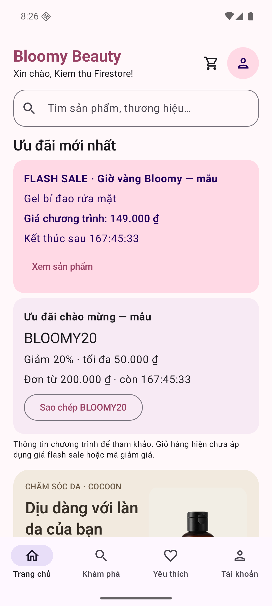
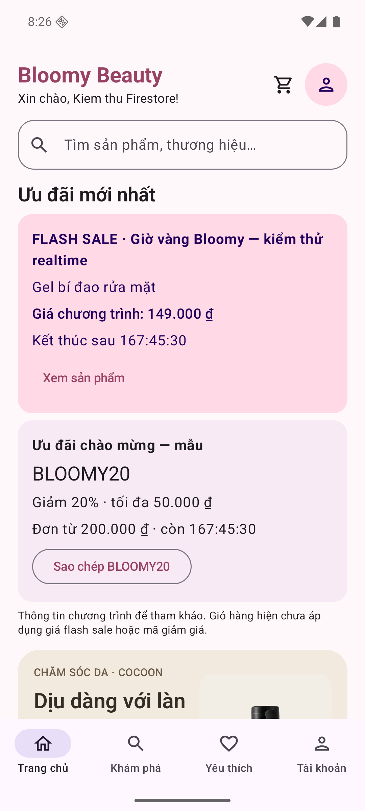
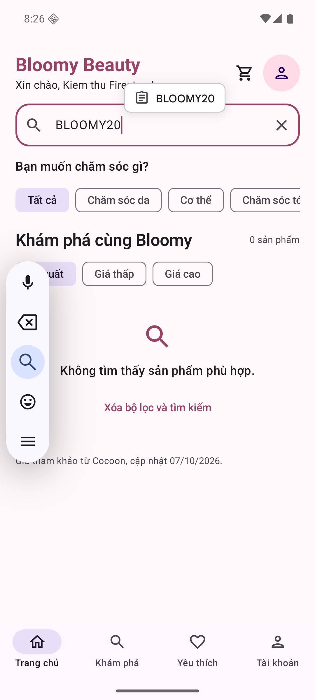
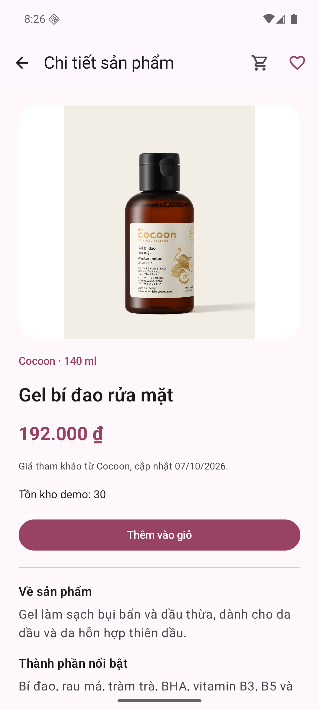

# Kiểm thử Firestore trực tiếp — 21/10/2026

Kết quả: **6 hạng mục đạt** trên ứng dụng thật, khoảng 20:26 giờ Việt Nam.
Project `bloomy-beauty`, database `(default)`, Android Emulator `emulator-5554`.
Dùng tài khoản thử cục bộ `firestore.qa.20261021@bloomy.demo`.

| Hạng mục | Kết quả quan sát | Trạng thái |
|---|---|---|
| Đọc dữ liệu thật | Hai document có `published = true`, thời gian chương trình còn hiệu lực | Đạt |
| Hiển thị ưu đãi | Gel bí đao rửa mặt giá chương trình 149.000đ; `BLOOMY20` giảm 20%, tối đa 50.000đ, đơn từ 200.000đ; có đếm ngược | Đạt |
| Cập nhật realtime | Đổi tiêu đề flash sale thành `Giờ vàng Bloomy — kiểm thử realtime`; màn hình tự cập nhật, không điều hướng hoặc tải lại | Đạt |
| Khôi phục dữ liệu | Khôi phục tiêu đề gốc, màn hình tự cập nhật lại; đọc lại xác nhận toàn bộ fields hai document khớp trước kiểm thử | Đạt |
| Sao chép mã | Nhấn sao chép, dán từ clipboard vào ô tìm kiếm; giá trị đúng `BLOOMY20` | Đạt |
| Mở chi tiết sản phẩm | Nhấn `Xem sản phẩm`, mở đúng Gel bí đao rửa mặt, giá catalog 192.000đ đúng phạm vi hiện tại; quay lại trang chủ thành công | Đạt |

Không sửa mã nguồn hoặc rules trong lần kiểm thử này. Thay đổi remote duy nhất là
**tiêu đề document flash sale mẫu**, đã khôi phục; `published` cả hai vẫn là `true`.
Lệnh cập nhật/khôi phục dùng điều kiện `updateTime` để tránh ghi đè sửa đổi đồng thời.
Ô tìm kiếm đã được xóa và ứng dụng để lại ở trang chủ sau kiểm thử.

Phạm vi xác nhận: công bố ưu đãi realtime và sao chép mã. Giá flash sale/mã giảm
giá chưa áp dụng vào giỏ hàng hoặc đơn hàng, đúng thông báo hiện có trên giao diện.
Không gửi thông báo FCM, không kiểm thử thanh toán hoặc quota nhận mã trong lượt này.

## Ảnh chụp gốc từ máy ảo

Ảnh PNG lấy trực tiếp bằng `adb exec-out screencap -p`, không chỉnh sửa.

### 1. Hiển thị đồng thời hai chương trình

### 2. Thay đổi tiêu đề đến giao diện qua listener realtime

### 3. Tiêu đề gốc được khôi phục

### 4. Mã sao chép được dán chính xác vào ô tìm kiếm

### 5. Mở đúng chi tiết sản phẩm

Dữ liệu xác nhận máy đọc được: [ket-qua.json](ket-qua.json).
