# Bài tập cá nhân: Mua lại đơn cũ

Môn Lập trình di động · Bloomy Beauty – Nhóm 4 · Ngày 16/11/2026

Họ và tên: **Nguyễn Duy Thuân** · MSSV: **25TX810025**

[Bài nộp Word](25TX810025_NguyenDuyThuan.docx) · [Kế hoạch](../../20261116000000_ke-hoach-mua-lai-don-cu.md) · [Kiểm thử](../../kiem-thu/reorder-2026-11-16/README.md)

## 1. Yêu cầu bài tập

Bài tập cá nhân môn Lập trình di động: xây dựng tính năng Mua lại đơn cũ trong ứng dụng Bloomy Beauty. Khách mở đơn đã giao hoặc đã hủy của chính mình, xem trước các mặt hàng có thể mua lại, xác nhận gộp vào giỏ rồi đặt đơn mới qua quy trình COD hiện có. Dữ liệu dùng SQLite trên một thiết bị, có thể chạy ngoại tuyến.

Nền đã có gồm lịch sử/chi tiết đơn, giỏ hàng, kiểm tra giá và tồn, nháp giao hàng và cơ chế khôi phục checkout. Phần bổ sung gồm nút Mua lại, bản xem trước, transaction gộp nhiều dòng, kiểm tra lại dữ liệu trước khi ghi và điều hướng về đúng bước sản phẩm trong giỏ. Không thay SQLite schema 11.

## 2. Thiết kế và triển khai tính năng

Luồng chính: OrdersScreen → ReorderViewModel → ReorderRepository.preview → hiển thị xem trước → ReorderRepository.confirm → CartViewModel.openAfterReorder → giỏ hàng → checkout COD. Preview chỉ đọc dữ liệu; repository xác nhận kiểm tra lại phiên đăng nhập, chủ sở hữu và trạng thái đơn trong transaction.

Với số lượng c đã có trong giỏ, q của đơn cũ và giới hạn L = min(tồn hiện tại, 99), lượng thêm là min(q, max(0, L − c)) khi dòng hợp lệ. Giữ các sản phẩm khác trong giỏ. Thiếu tồn thì thêm phần còn đủ; sản phẩm bị xóa, ngừng bán, hết hàng hoặc giỏ đã đạt giới hạn được bỏ qua kèm lý do. Nếu lượng c đang vượt tồn thì giữ nguyên và yêu cầu khách điều chỉnh.

Giá mua lại lấy từ catalog hiện tại, hiển thị thay đổi so với snapshot đơn cũ. Dòng đang có trong giỏ chưa chấp nhận giá mới phải được xử lý bằng luồng xác nhận giá hiện có trước khi mua lại. Tiền dùng Long và phép tính có kiểm tra tràn. Tạm tính preview chỉ là phần hàng thêm, chưa gồm phí giao hàng và ưu đãi.

Confirm đọc lại đơn, giỏ, sản phẩm và checkout, đối chiếu với dữ liệu đã xem trước. Nếu thay đổi, không ghi và yêu cầu xem/xác nhận lại. Nếu khớp, gộp toàn bộ dòng đủ điều kiện và xóa checkout nháp trong cùng transaction. Lỗi ghi bất kỳ dòng nào rollback toàn bộ; chống nhấn đúp và chống dùng lại preview đã commit.

Không sao chép giá, coupon, phí hoặc địa chỉ của đơn cũ. Giữ nháp giao hàng hiện tại; xóa trạng thái review/coupon cũ khi mở giỏ sau mua lại. Kết quả checkout đã tạo đơn nhưng chưa xem xong phải được hoàn tất trước. Thêm giỏ không trừ kho, không tạo đơn, không tạo thông báo đơn và không làm đổi lịch sử/PDF/đánh giá của đơn cũ.

Các ảnh code sau được kết xuất từ mã Kotlin hiện tại, có đường dẫn và số dòng; đây là ảnh trích mã nguồn, không phải ảnh chụp IDE. Chỉ xuống hàng khi hiển thị, không sửa nội dung code.

### Quy tắc gộp số lượng

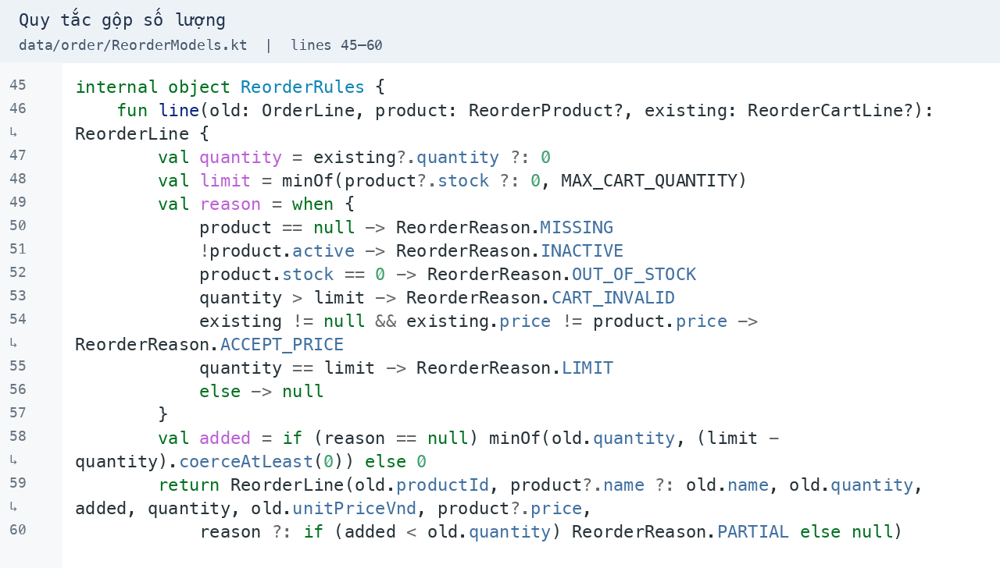

Nguồn: [app/src/main/java/com/example/bloomybeauty/data/order/ReorderModels.kt](../../../app/src/main/java/com/example/bloomybeauty/data/order/ReorderModels.kt) — dòng 45–60

Dùng giá hiện tại, giới hạn theo tồn kho và mức 99 đơn vị. Phân biệt sản phẩm mất/ngừng bán/hết hàng, giỏ vượt tồn và giá chưa được chấp nhận.

### Xác nhận trong một transaction

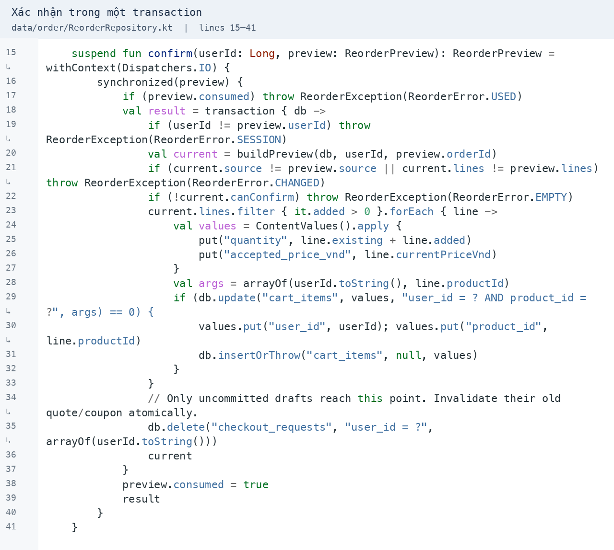

Nguồn: [app/src/main/java/com/example/bloomybeauty/data/order/ReorderRepository.kt](../../../app/src/main/java/com/example/bloomybeauty/data/order/ReorderRepository.kt) — dòng 15–41

Đọc lại và đối chiếu nguồn preview, gộp các dòng rồi xóa checkout nháp trong cùng transaction. Chỉ đánh dấu preview đã sử dụng sau khi commit thành công; lỗi ghi rollback toàn bộ.

### Kiểm tra phiên và quyền sở hữu

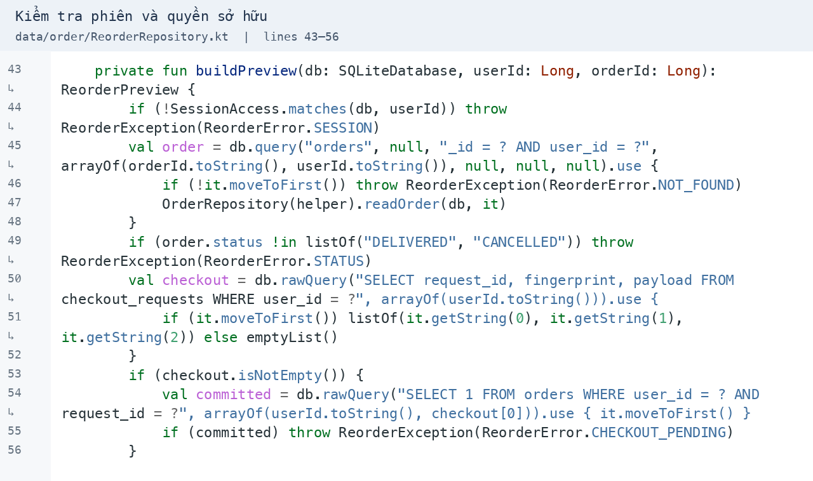

Nguồn: [app/src/main/java/com/example/bloomybeauty/data/order/ReorderRepository.kt](../../../app/src/main/java/com/example/bloomybeauty/data/order/ReorderRepository.kt) — dòng 43–56

Kiểm tra phiên hiện hành, tìm đơn theo cả orderId và userId, chỉ cho phép trạng thái DELIVERED/CANCELLED. Kết quả checkout đã commit phải được hoàn tất trước khi mua lại.

### Trạng thái xác nhận và dữ liệu thay đổi

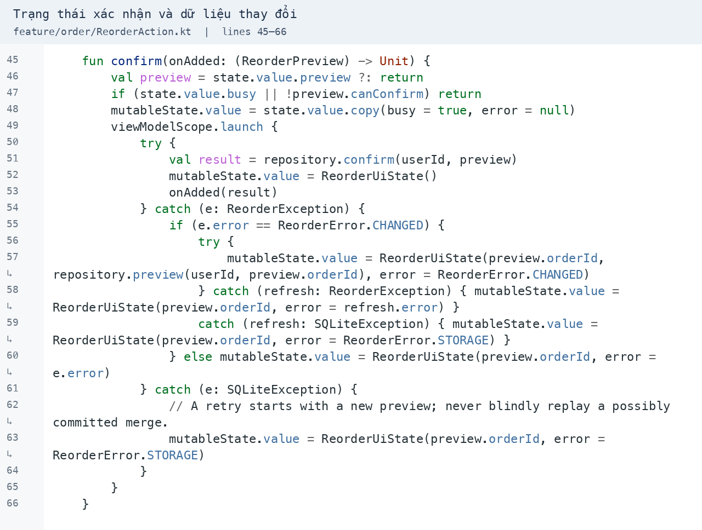

Nguồn: [app/src/main/java/com/example/bloomybeauty/feature/order/ReorderAction.kt](../../../app/src/main/java/com/example/bloomybeauty/feature/order/ReorderAction.kt) — dòng 45–66

Khóa nhấn lặp trong lúc xử lý. Khi dữ liệu thay đổi, tải preview mới và giữ thông báo yêu cầu xác nhận lại; lỗi lưu trữ không được tự gửi lại thao tác gộp.

### Đưa giỏ về bước sản phẩm

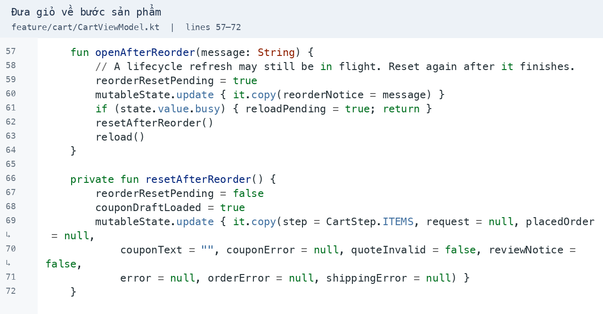

Nguồn: [app/src/main/java/com/example/bloomybeauty/feature/cart/CartViewModel.kt](../../../app/src/main/java/com/example/bloomybeauty/feature/cart/CartViewModel.kt) — dòng 57–72

Xóa request, coupon và trạng thái review cũ, giữ nháp giao hàng. Nếu refresh còn chạy, đặt cờ để reset và tải lại sau khi refresh kết thúc.

## 3. Minh chứng màn hình theo thứ tự sử dụng

8 ảnh được lấy từ lần chạy ReorderFlowTest trên Pixel_6 mới, Android 15/API 35, ARM64, ngày 16/11/2026. Ảnh thể hiện thao tác Compose với repository và SQLite thật trong database kiểm thử riêng reorder-flow-test.db; fixture được dọn sau mỗi ca. Đây là nhiều ca độc lập sắp theo luồng giải thích, không phải một phiên mua hàng liên tục.

Pixel_6 được tạo lại theo yêu cầu sau nâng cấp macOS. Báo cáo dùng kết quả cuối trên API 35; không dùng lượt API 37 lỗi tương thích Espresso làm kết quả nghiệm thu. Ảnh giữ nguyên nội dung từ hồ sơ kiểm thử đã lưu, không dựng lại bằng mockup và không chụp một lượt mới khi tạo báo cáo.

### Lối vào Mua lại từ chi tiết đơn

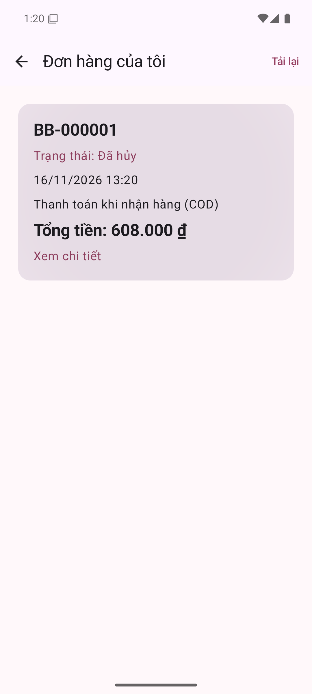

Đơn đã hủy có nút Mua lại. Nút cũng được hỗ trợ cho đơn đã giao của chính tài khoản.

### Xem trước trước khi xác nhận

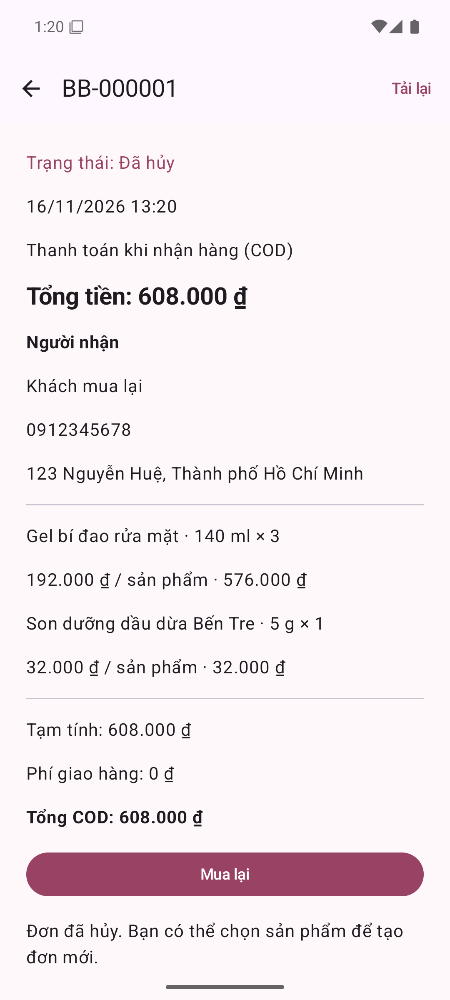

Hiển thị số lượng yêu cầu, thêm được, lượng đang có trong giỏ và giá hiện tại. Hủy không làm thay đổi giỏ.

### Giỏ hàng sau khi gộp

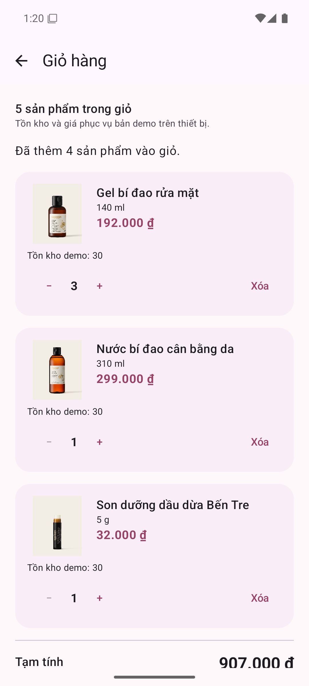

Thêm các dòng đủ điều kiện, giữ mặt hàng đã có và báo kết quả. Chưa tạo đơn hay trừ tồn kho.

### Đặt đơn COD mới

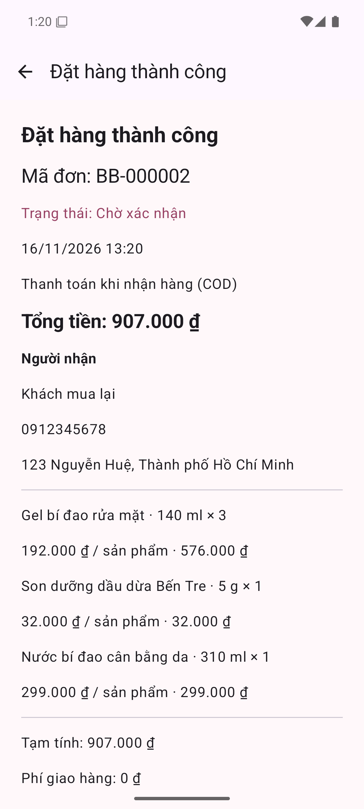

Khách tiếp tục kiểm tra giao hàng và xác nhận COD qua luồng checkout hiện có. Snapshot đơn cũ được giữ nguyên.

### Thiếu tồn, đổi giá và ngừng bán

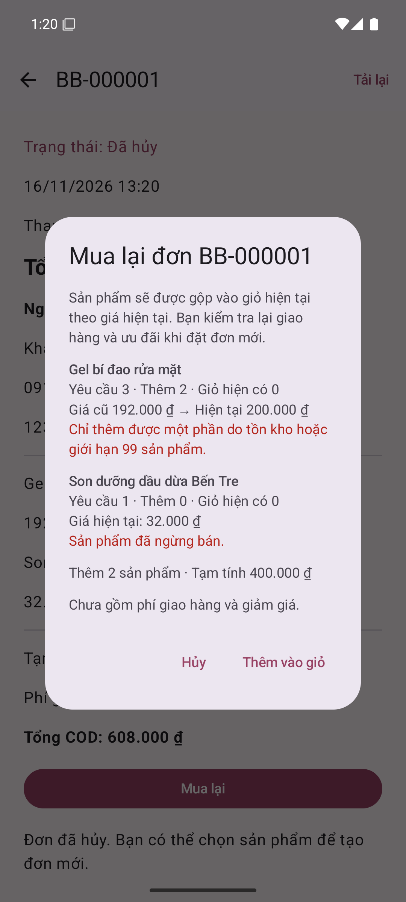

Bản xem trước giải thích phần số lượng bị giảm, giá cũ so với giá hiện tại và sản phẩm không còn bán.

### Kết quả mua lại một phần

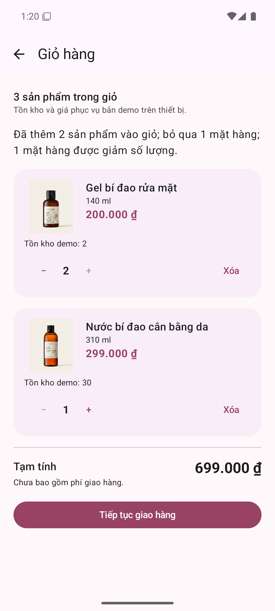

Giỏ hiển thị lượng thực tế đã thêm, số mặt hàng bị bỏ qua và số mặt hàng giảm lượng.

### Dữ liệu thay đổi sau xem trước

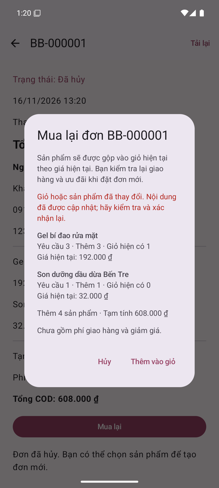

Repository phát hiện giỏ đã đổi, tải lại bản xem trước và yêu cầu xác nhận lần nữa; không tự áp dụng kết quả mới.

### Không còn mặt hàng mua được

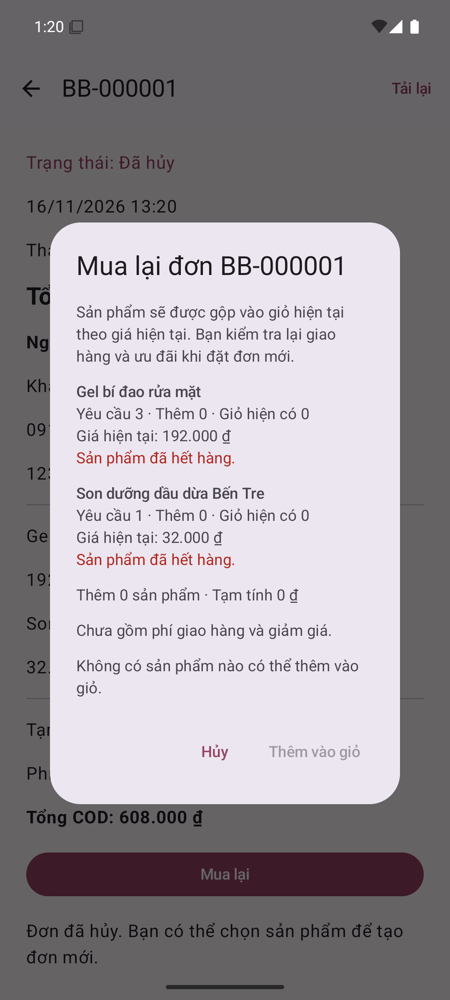

Mọi dòng không khả dụng đều có lý do. Nút Thêm vào giỏ bị vô hiệu hóa; dữ liệu giỏ được giữ nguyên.

## 4. Kiểm thử và kết quả bài tập

Android: 57/57 ca đạt, 0 lỗi, 0 bỏ qua trong lượt cuối trên Pixel_6 API 35. Trong đó 21 ca mới trực tiếp cho Mua lại gồm ReorderRepositoryTest 14 ca và ReorderFlowTest 7 ca; 36 ca còn lại là hồi quy giỏ, đơn, refresh checkout và tích hợp thương mại. Đây là bộ liên quan, không phải toàn bộ kiểm thử ứng dụng.

JVM: 71/71 ca đạt, 0 lỗi, 0 bỏ qua; gồm 9 ca mới ReorderRulesTest. Một ca kiểm tra 2.400 tổ hợp số lượng/tồn để bảo đảm không vượt giới hạn và không tự giảm lượng hàng đang có. Lint debug: 0 error/fatal, 71 warning, 1 information. Build demo và APK kiểm thử thành công.

Các trường hợp đã kiểm tra: gộp giỏ rỗng/trùng sản phẩm, thiếu tồn, giới hạn 99, sản phẩm thiếu/ngừng bán/hết hàng, đổi giá, tài khoản khác/phiên cũ, dữ liệu thay đổi sau preview, xác nhận đồng thời, rollback lỗi ghi và lỗi xóa checkout, giữ dữ liệu sau mở lại DB, giữ snapshot lịch sử và đặt đơn mới. UI kiểm tra Hủy, khôi phục activity không tự thêm, thông báo kết quả và khóa xác nhận khi không còn dòng hợp lệ.

Trong quá trình kiểm thử, hai assertion của báo cáo thông báo được sửa để so khớp chuỗi con; helper checkout cũ được bổ sung đóng bàn phím và chờ idle trước khi bấm nút lưu. Lượt cuối OK (57 tests); các thiết lập animation đã được khôi phục. Các lỗi/lượt trước được giữ trong hồ sơ kiểm thử, không cộng vào kết quả cuối.

Phạm vi nghiệm thu là bản demo SQLite trên một thiết bị. Chưa kiểm thử thiết bị thật, thanh toán online hoặc đồng bộ nhiều thiết bị. Bản xem trước không giữ chỗ tồn kho; quy trình tạo đơn vẫn kiểm tra lại giá/tồn trước khi trừ kho. Không mô tả việc đóng/mở helper SQLite hoặc recreate activity thành kiểm thử khởi động lại hệ điều hành.
