# Bài tập cá nhân: Sản phẩm yêu thích

Môn Lập trình di động · Bloomy Beauty · Ngày 09/11/2026

Họ và tên: **[Điền họ và tên]** · MSSV: **[Điền MSSV]** · Lớp: **[Điền lớp]**

[Bài nộp Word](25TX810025_NguyenDuyThuan.docx) · [Kế hoạch](../../ke-hoach-yeu-thich.md) · [Kiểm thử](../../kiem-thu/pixel6-favorites-2026-11-09/README.md)

## 1. Yêu cầu bài tập

Bài tập cá nhân môn Lập trình di động: xây dựng và hoàn thiện tính năng Sản phẩm yêu thích trong ứng dụng Bloomy Beauty. Người dùng có thể lưu/bỏ lưu sản phẩm, xem danh sách riêng theo tài khoản và thêm sản phẩm vào giỏ. Dữ liệu dùng SQLite trên thiết bị, không cần backend.

Nền đã có: bảng favorites với khóa ghép tài khoản/sản phẩm, tab Yêu thích và nút tim trên thẻ/chi tiết. Phần hoàn thiện trong bài tập: lối vào từ Tài khoản, bộ lọc riêng, trạng thái rỗng phù hợp, tồn kho trên thẻ, thêm nhanh giỏ và lọc badge theo sản phẩm còn hoạt động.

## 2. Thiết kế và triển khai tính năng

Bảng favorites gồm user_id và product_id, khóa chính ghép chống trùng và khóa ngoại xóa theo tài khoản/sản phẩm. CatalogRepository xử lý dữ liệu; HomeViewModel cung cấp trạng thái cho HomeScreen. Tận dụng schema 11; không migration, không xóa dữ liệu demo. Lưu/bỏ lưu trong transaction và kiểm tra phiên đăng nhập. Không thêm mục không tồn tại/ngừng bán; vẫn cho bỏ lưu mục cũ. Đếm các mục đang bán, giữ sản phẩm hết hàng trong danh sách.

Luồng lưu/bỏ lưu: HomeScreen nhận thao tác tim → HomeViewModel.toggleFavorite → CatalogRepository kiểm tra SessionAccess trong transaction → xóa dòng nếu đã lưu hoặc thêm dòng nếu sản phẩm còn hoạt động → tải lại snapshot và cập nhật UI. Luồng thêm giỏ gọi CartViewModel.add và giữ nguyên dữ liệu yêu thích.

Tìm kiếm/danh mục/sắp xếp của Yêu thích được lưu riêng theo tài khoản bằng rememberSaveable. Tìm kiếm ở trang chủ không che danh sách đã lưu. Danh sách rỗng có nút Khám phá; kết quả lọc rỗng có nút xóa lọc. Thêm giỏ qua CartViewModel/CartRepository hiện có, không bỏ lưu sản phẩm.

Các ảnh dưới được kết xuất trực tiếp từ mã nguồn Kotlin hiện tại, có số dòng và đường dẫn file; đây là ảnh trích code phục vụ bài tập, không phải ảnh chụp IDE. Các dòng dài chỉ được xuống hàng khi hiển thị, không sửa mã nguồn.

### 2.1. Bảng lưu sản phẩm yêu thích

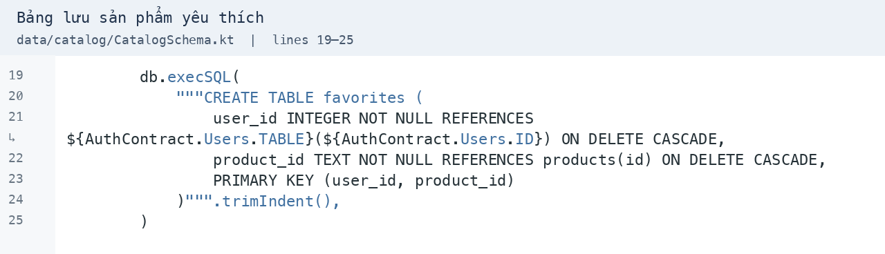

Nguồn: [CatalogSchema.kt, dòng 19–25](../../../app/src/main/java/com/example/bloomybeauty/data/catalog/CatalogSchema.kt)

Khóa chính ghép chống lưu trùng; hai khóa ngoại gắn mục yêu thích với tài khoản và sản phẩm, hỗ trợ ON DELETE CASCADE.

### 2.2. Lưu và bỏ lưu trong transaction

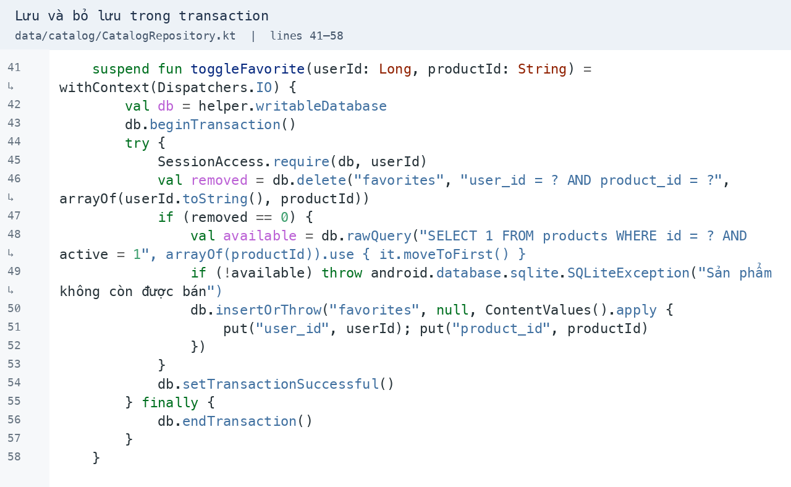

Nguồn: [CatalogRepository.kt, dòng 41–58](../../../app/src/main/java/com/example/bloomybeauty/data/catalog/CatalogRepository.kt)

Kiểm tra phiên trước khi ghi. Xóa nếu đã lưu; nếu chưa lưu, chỉ thêm sản phẩm còn hoạt động. Transaction bảo đảm thao tác hoàn tất hoặc được rollback.

### 2.3. Cập nhật trạng thái giao diện

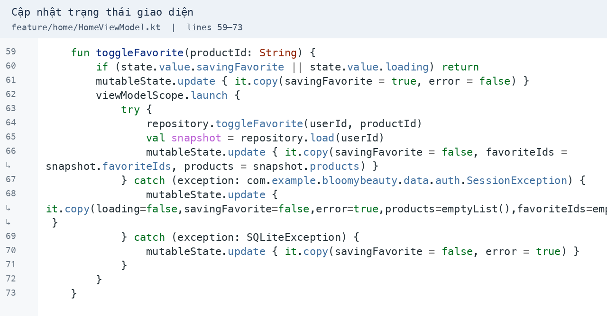

Nguồn: [HomeViewModel.kt, dòng 59–73](../../../app/src/main/java/com/example/bloomybeauty/feature/home/HomeViewModel.kt)

Chặn nhấn lặp khi đang lưu, chạy coroutine, tải lại snapshot và cập nhật StateFlow. Khi phiên không hợp lệ, xóa dữ liệu riêng khỏi trạng thái màn hình.

### 2.4. Bộ lọc riêng của Yêu thích

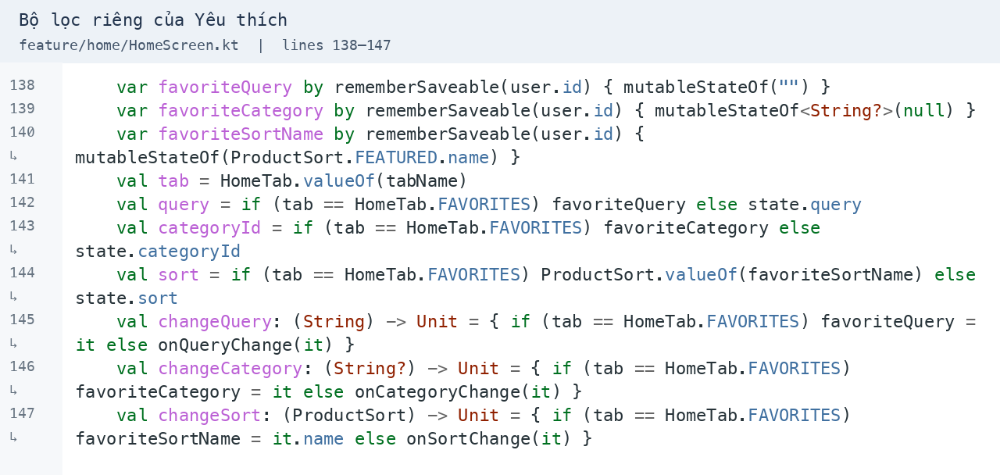

Nguồn: [HomeScreen.kt, dòng 138–147](../../../app/src/main/java/com/example/bloomybeauty/feature/home/HomeScreen.kt)

Lưu bộ lọc theo tài khoản bằng rememberSaveable. Khi vào tab Yêu thích, dùng query, danh mục và sắp xếp riêng thay vì bộ lọc trang chủ.

### 2.5. Tồn kho và thêm nhanh vào giỏ

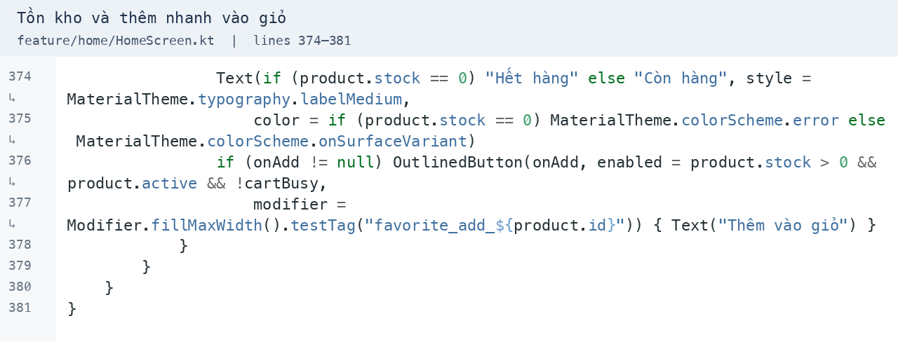

Nguồn: [HomeScreen.kt, dòng 374–381](../../../app/src/main/java/com/example/bloomybeauty/feature/home/HomeScreen.kt)

Thẻ hiển thị Còn hàng/Hết hàng. Chỉ bật thêm giỏ khi sản phẩm đang bán, còn tồn và giỏ không bận; testTag giúp kiểm thử đúng nút của sản phẩm.

## 3. Minh chứng màn hình theo thứ tự sử dụng

11 ảnh mới được chụp bằng UI Automation khi chạy giao diện Compose trên AVD Pixel_6, API 36, ngày 09/11/2026. Dữ liệu tài khoản và tồn kho là fixture kiểm thử trong favorites_flow_test.db; thao tác dùng repository và SQLite thật. Ảnh sắp xếp theo luồng báo cáo, gồm nhiều ca kiểm thử độc lập; không phải một phiên mua hàng duy nhất.

Kiểm thử dùng database riêng và dọn sau mỗi ca; cài đè bằng adb install -r, không xóa dữ liệu gói demo. Chỉ mở lại AVD Pixel_6 đã có, không tạo máy ảo mới.

### Lối vào từ Tài khoản

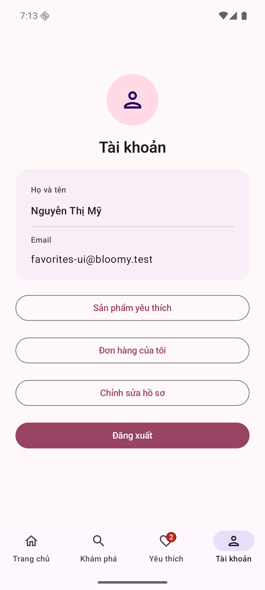

Nút Sản phẩm yêu thích mở danh sách riêng của tài khoản đang đăng nhập.

### Lưu từ thẻ sản phẩm

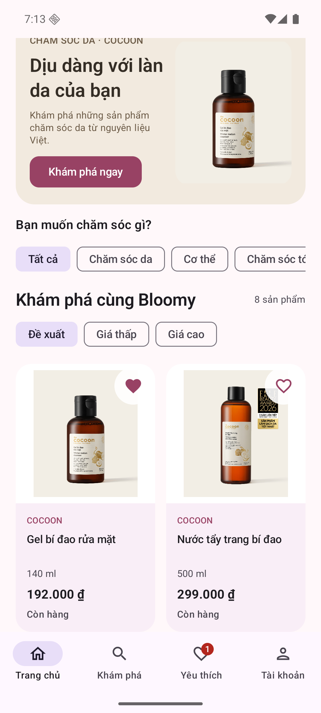

Nhấn tim tại danh mục; tim đổi trạng thái và badge được cập nhật.

### Lưu từ chi tiết

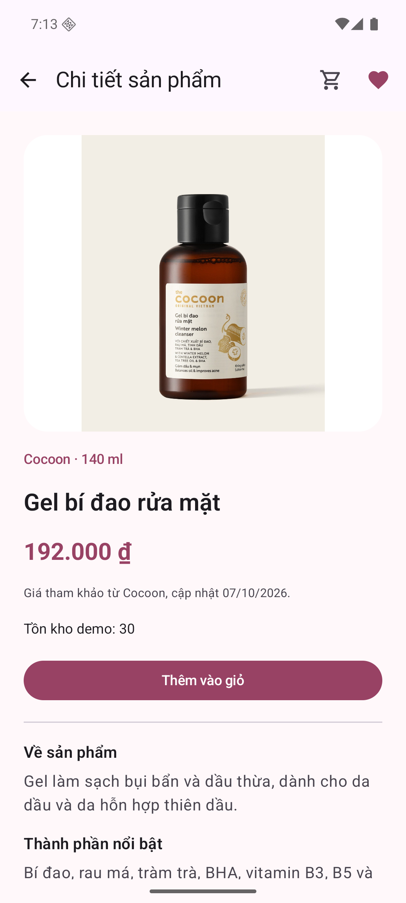

Sau bỏ lưu và lưu lại ở trang chi tiết, tim phản ánh trạng thái SQLite.

### Đồng bộ danh sách

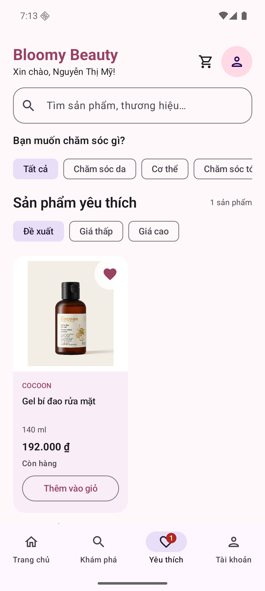

Quay về tab Yêu thích hiển thị đúng một sản phẩm vừa lưu.

### Thêm nhanh vào giỏ

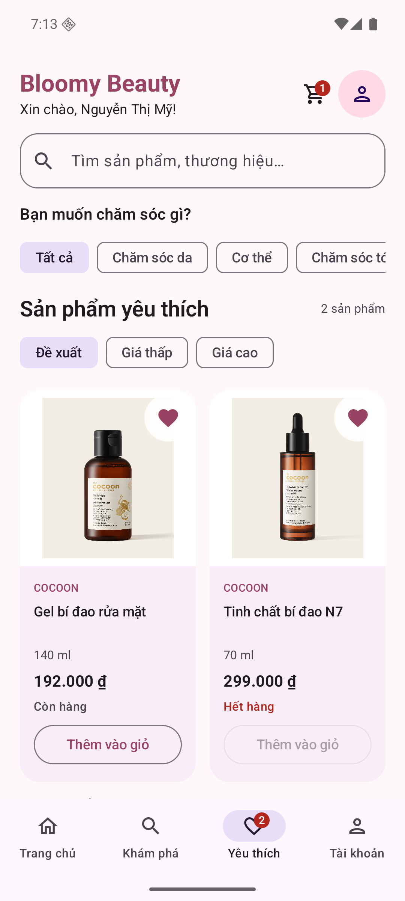

Bộ lọc trang chủ không che danh sách; thêm giỏ thành công, vẫn giữ mục yêu thích.

### Sản phẩm hết hàng

Tinh chất vẫn xuất hiện, hiển thị Hết hàng và vô hiệu hóa nút thêm giỏ.

### Chi tiết đã lưu

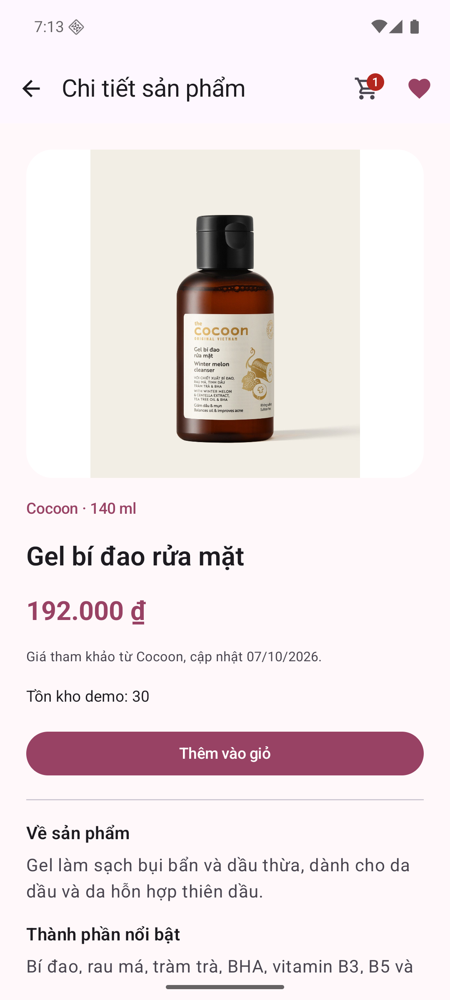

Mở sản phẩm từ Yêu thích; tim có mô tả bỏ khỏi yêu thích.

### Bỏ lưu tại chi tiết

Tim chuyển rỗng sau thao tác, danh sách cập nhật khi quay lại.

### Đã bỏ lưu toàn bộ

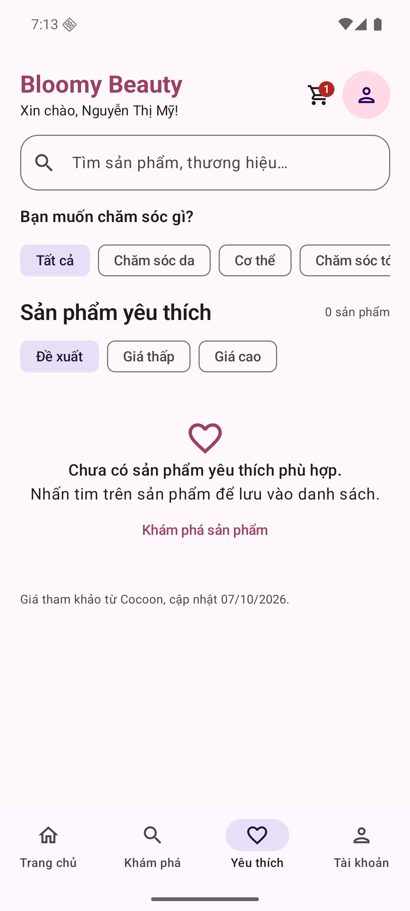

Thông báo rỗng hướng dẫn nhấn tim và có nút Khám phá sản phẩm.

### Tìm kiếm không khớp

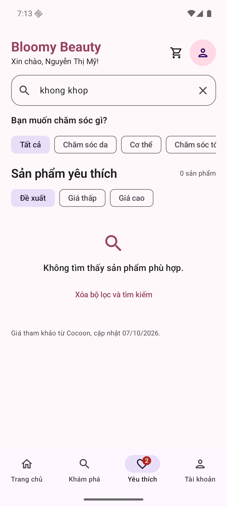

Danh sách vẫn có dữ liệu nhưng bộ lọc không khớp; có nút xóa bộ lọc.

### Xóa bộ lọc

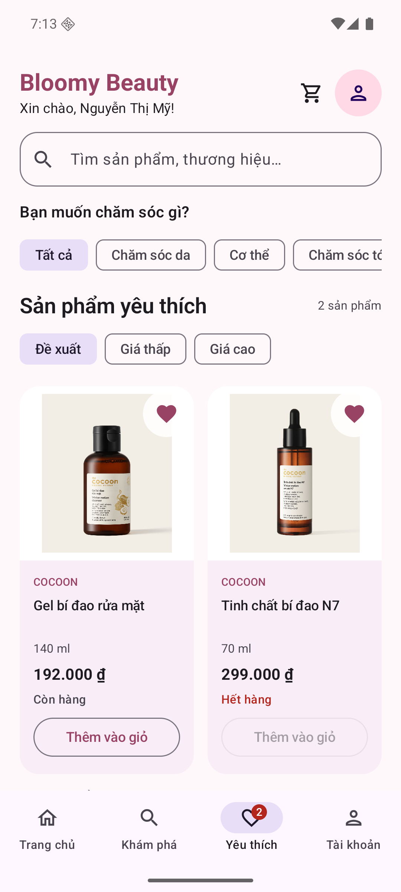

Hai sản phẩm đã lưu xuất hiện lại, không mất dữ liệu yêu thích.

## 4. Kiểm thử và kết quả bài tập

Android: 26/26 ca đạt, 0 bỏ qua. Phạm vi: FavoritesFlowTest, CatalogRepositoryTest, SessionIsolationTest, HomeFlowTest, CartRepositoryTest, CartFlowTest. Kiểm tra lưu qua mở lại database, tách tài khoản, phiên cũ, sản phẩm xóa/ngừng bán/hết hàng, giao diện và hồi quy giỏ. Đây là bộ liên quan, không phải chạy lại toàn bộ ứng dụng.

JVM: 62 ca, 0 lỗi xác nhận, 0 lỗi chạy, 0 bỏ qua. Lint debug: 0 error/fatal, 68 warning, 1 information. Các cảnh báo còn tồn tại được giữ trong báo cáo lint đính kèm.

Đã kiểm tra thao tác lưu từ thẻ/chi tiết, đồng bộ danh sách, bộ lọc độc lập, bỏ lưu và thêm giỏ; sản phẩm hết hàng không thể thêm từ thẻ. Kiểm tra tồn tại dữ liệu sử dụng đóng/mở helper SQLite và đăng nhập lại, không gọi là kiểm tra khởi động lại hệ điều hành.

Thiết bị thật để đợt sau theo yêu cầu. Không kiểm thử backend, thanh toán online hoặc đồng bộ nhiều thiết bị; các mục này nằm ngoài phạm vi demo. Bài nộp tập trung vào tính năng Sản phẩm yêu thích; các ca giỏ hàng và bảo mật chỉ là hồi quy liên quan.
