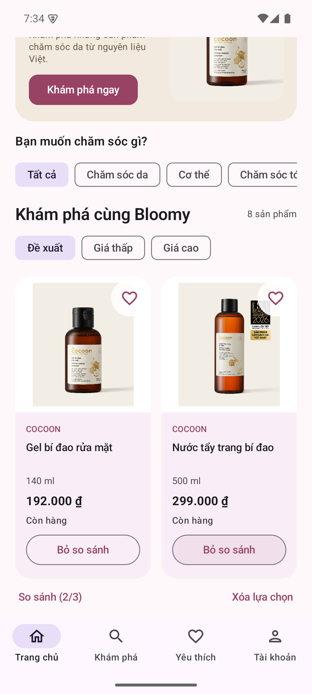
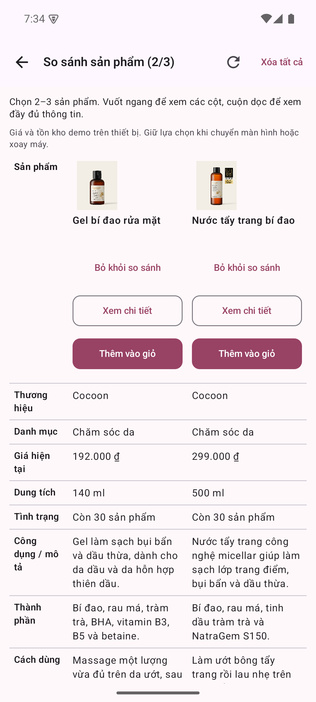
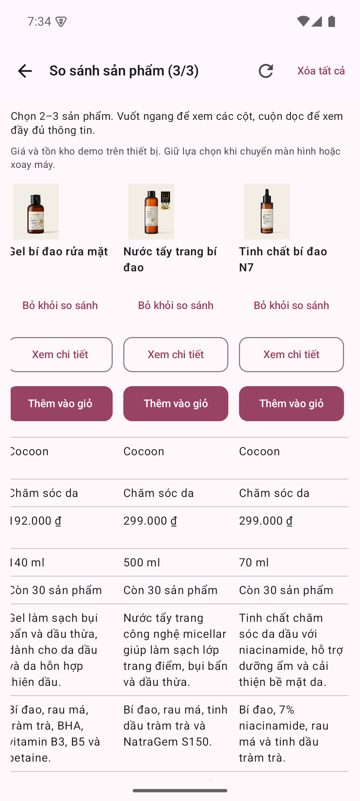
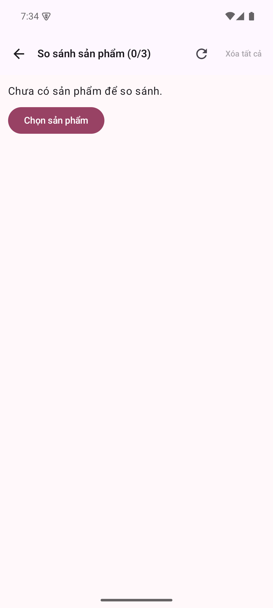
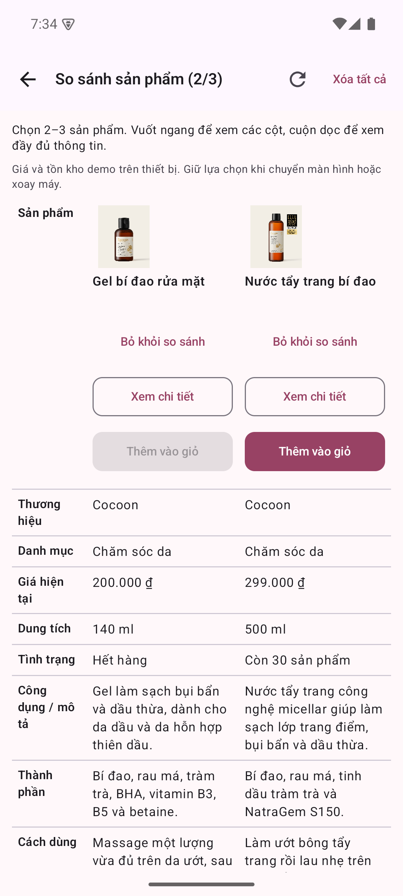
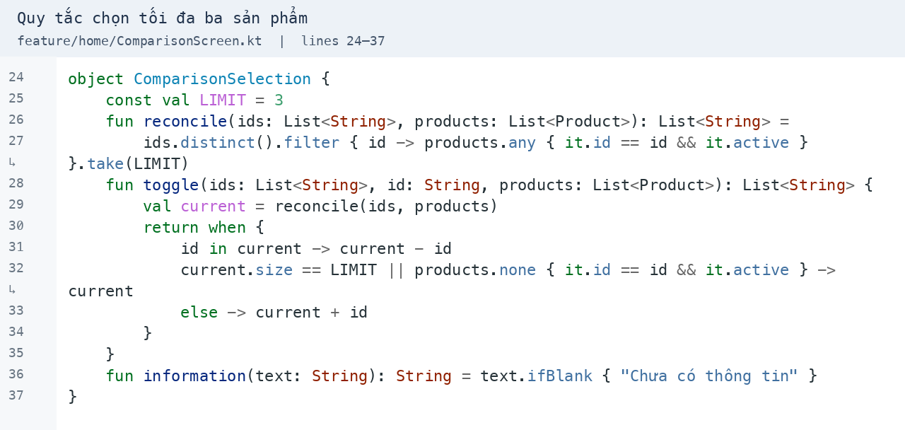
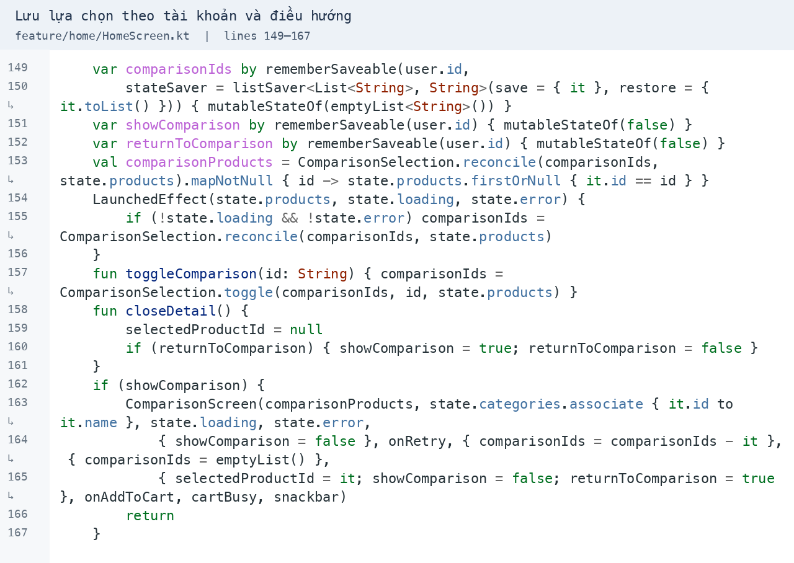
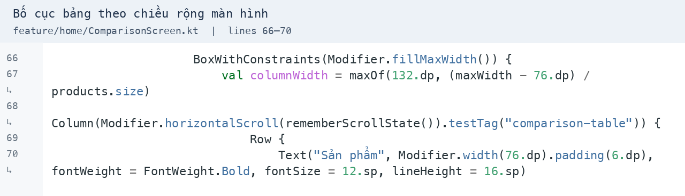
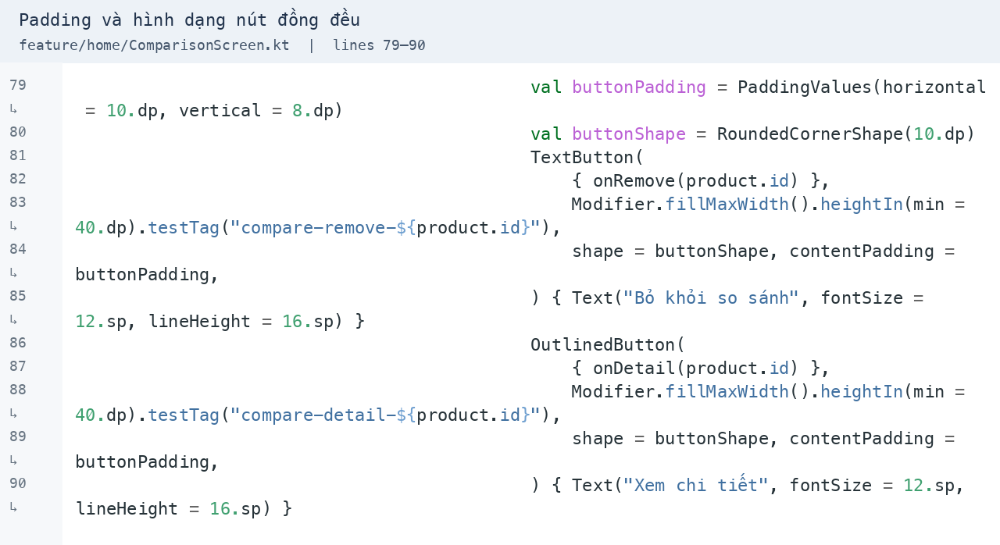
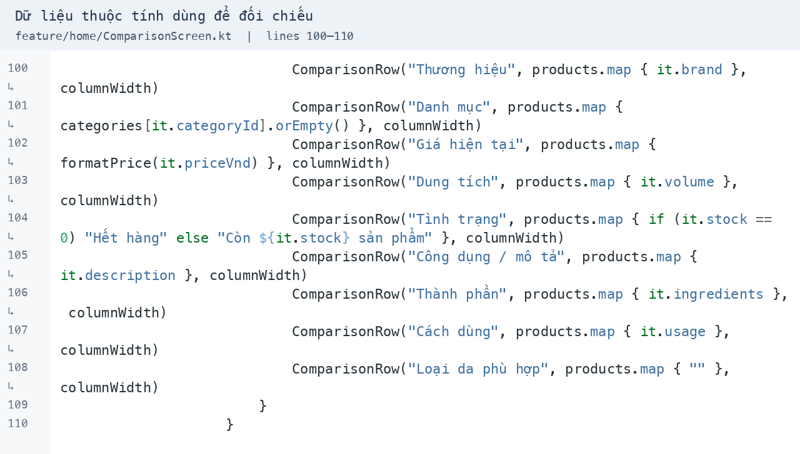

# Báo cáo thực hành: So sánh sản phẩm

**Phạm Văn Bình · 25TX610001** · Lập trình di động · Bloomy Beauty · 16/11/2026

[Báo cáo Word](25TX610001_PhamVanBinh.docx) · [Kiểm thử](../../kiem-thu/comparison-2026-11-16/README.md)

| THÔNG TIN | NỘI DUNG |
| --- | --- |
| Sinh viên | Phạm Văn Bình |
| Mã số sinh viên | 25TX610001 |
| Ứng dụng | Bloomy Beauty — Nhóm 4 |
| Ngày thực hiện | 16/11/2026 |
| Phạm vi | Ứng dụng Android, dữ liệu cục bộ trên một thiết bị |

## NỘI DUNG BÁO CÁO

| PHẦN | NỘI DUNG |
| --- | --- |
| I | Mục tiêu và phạm vi |
| II | Giải pháp thiết kế |
| III | Kết quả kiểm chứng |
| IV | Hồ sơ giao diện |
| V | Phụ lục mã nguồn |
| VI | Tài liệu đối chiếu |

## I. MỤC TIÊU VÀ PHẠM VI

Bài tập cá nhân môn Lập trình di động: xây dựng tính năng So sánh sản phẩm cho ứng dụng Bloomy Beauty. Người dùng chọn từ hai đến ba sản phẩm từ danh mục hoặc chi tiết, xem các thuộc tính theo hàng, bỏ từng mục, xóa toàn bộ, xem chi tiết và thêm sản phẩm phù hợp vào giỏ.

Ứng dụng đã có catalog, Yêu thích, chi tiết sản phẩm và giỏ hàng dùng SQLite trên thiết bị. Tính năng bổ sung trạng thái lựa chọn và màn hình so sánh; không tạo bảng mới, không thay schema SQLite 11. Danh sách so sánh là trạng thái giao diện theo tài khoản, không phải danh sách lưu vĩnh viễn trong cơ sở dữ liệu.

| YÊU CẦU | QUY TẮC THỰC HIỆN |
| --- | --- |
| Lựa chọn | Chọn 2–3 mục, không trùng; bỏ một mục để thay thế khi đã đủ ba. |
| Dữ liệu | Giá/tồn và nội dung từ catalog hiện tại; không tự suy đoán loại da. |
| Trạng thái | Giữ lựa chọn khi điều hướng/recreate; tách theo tài khoản. |
| Giỏ hàng | Thêm qua luồng kiểm tra có sẵn; không tự tạo đơn hoặc giữ chỗ tồn kho. |

## II. GIẢI PHÁP THIẾT KẾ

| THÀNH PHẦN | VAI TRÒ |
| --- | --- |
| ComparisonSelection | Giới hạn lựa chọn, loại trùng/ID mất hoặc ngừng bán. |
| HomeScreen | Lưu ID theo tài khoản, chọn từ thẻ/chi tiết, nối điều hướng. |
| ComparisonScreen | Bảng thuộc tính, bỏ/xóa, xem chi tiết và callback thêm giỏ. |
| Catalog / Cart | Cung cấp dữ liệu hiện tại và kiểm tra thao tác giỏ bằng repository hiện có. |

Luồng sử dụng: thẻ sản phẩm hoặc trang chi tiết → chọn/bỏ so sánh → thanh So sánh (n/3) → ComparisonScreen. Chỉ mở bảng từ thanh khi có ít nhất hai mục; giới hạn tối đa ba. Khi đã đủ ba, các nút chọn mục chưa có bị khóa, còn nút bỏ mục đã chọn vẫn hoạt động. Tìm kiếm, danh mục và tab Yêu thích không làm mất lựa chọn.

ComparisonSelection xử lý ID: loại trùng, loại sản phẩm không còn hoạt động hoặc đã mất, giữ thứ tự người dùng chọn và giới hạn ba mục. HomeScreen lưu danh sách ID bằng rememberSaveable(user.id) với listSaver; mỗi lần hiển thị, ID được ghép lại với dữ liệu catalog hiện tại. Không lưu một bản Product cũ làm nguồn giá/tồn khi so sánh.

ComparisonScreen hiển thị tên/ảnh, thương hiệu, danh mục, giá hiện tại, dung tích, tình trạng tồn, công dụng/mô tả, thành phần và cách dùng. Bảng cuộn dọc; khi ba cột vượt chiều rộng thì vuốt ngang. Vùng nhãn 76dp, cột sản phẩm tối thiểu 132dp và được phân bổ theo chiều rộng hiện có để hai sản phẩm dễ xem hơn trên điện thoại portrait.

Giao diện đã thu gọn và chỉnh padding theo phản hồi: chữ bảng 12–13sp, chữ nút 12sp, ảnh 64dp; nút rộng đều theo cột, cao tối thiểu 40dp, đệm ngang 10dp/dọc 8dp, cách nhau 8dp và bo góc 10dp. Hàng tên dành tối thiểu hai dòng để cụm thao tác thẳng hàng hơn. Chiều cao nút có thể tự giãn khi nội dung cần xuống dòng.

Sản phẩm hết hàng vẫn được đối chiếu nhưng khóa Thêm vào giỏ. Khi catalog cập nhật, giá/tồn đổi theo nguồn và sản phẩm ngừng bán/xóa được loại khỏi lựa chọn. Đang tải hoặc lỗi thì ẩn bảng cũ và có thao tác thử lại/tải lại. Xóa còn một mục có hướng dẫn chọn thêm; xóa hết có lối quay lại danh mục.

Thao tác thêm giỏ đi qua callback đã có của HomeScreen vào CartViewModel/CartRepository, tiếp tục kiểm tra phiên, tồn và giá. Màn so sánh không giữ chỗ tồn và không tự tạo đơn. Xem chi tiết từ bảng rồi quay lại sẽ về bảng; lựa chọn được giữ khi mở giỏ rồi quay lại và khi recreate activity. Chuyển tài khoản làm sạch trạng thái lựa chọn.

Thông tin thiếu hiển thị Chưa có thông tin. Catalog chưa có trường loại da phù hợp riêng nên không tự phân loại từ mô tả; dung tích là văn bản nên chưa tính giá/ml hoặc giá/g. Không diễn giải việc giá một sản phẩm thấp hơn là rẻ hơn trên cùng đơn vị hoặc phù hợp hơn với mọi loại da.

## III. KẾT QUẢ KIỂM CHỨNG

| HẠNG MỤC | KẾT QUẢ ĐÃ GHI NHẬN |
| --- | --- |
| Unit test | 76/76 đạt; gồm 5 ca ComparisonSelectionTest mới. |
| Android mới | 6 ca UI + 1 ca integration đạt. |
| Android hồi quy | 12 ca Home/Yêu thích/giỏ + 2 ca recreate đạt; tổng 21 ca khác nhau. |
| Padding mới nhất | Chạy lại 7/7 UI/integration đạt; không cộng thêm vào 21 ca. |
| Lint / build | 0 lỗi lint, 71 cảnh báo, 1 thông tin; build demo và APK test đạt. |
| Thiết bị | Pixel_6, Android 15/API 35, ARM64. |

Unit test: 76/76 ca đạt, 0 lỗi, 0 bỏ qua; trong đó ComparisonSelectionTest mới có 5 ca. Kiểm tra thêm/bỏ, giới hạn ba, loại trùng/ID không hợp lệ/ngừng bán, thứ tự, hết hàng và nhãn thông tin thiếu. Lint debug: 0 error/fatal, 71 warning, 1 information; build demo và APK kiểm thử thành công.

Android: 21 ca khác nhau đạt trên Pixel_6 API 35, chia ba nhóm: ComparisonFlowTest 6 + ComparisonIntegrationTest 1; FavoritesFlowTest 3 + HomeFlowTest 2 + CartFlowTest 7; ShopRecreationTest 2. Mỗi nhóm kết thúc thành công, không bỏ qua và không có lỗi khôi phục animation. Đây là bộ liên quan, không phải chạy lại toàn bộ ứng dụng hoặc một lần chạy gộp 21/21.

Bộ mới kiểm tra lựa chọn từ thẻ/chi tiết, cần hai mục trước khi mở, ba cột/cuộn ngang, bỏ/xóa, xem chi tiết rồi quay lại, lọc không mất lựa chọn, recreate activity, đổi tài khoản, giá/tồn thay đổi, ẩn bảng khi loading/lỗi và retry. Integration đi qua BloomyApp: thêm cleanser từ bảng vào giỏ SQLite, kiểm tra lượng 1 và không có đơn mới, mở giỏ rồi quay lại vẫn có hai lựa chọn.

Các lượt chạy gộp trước gặp timeout ở ca checkout/đổi hướng của bộ cũ và lệnh ADB phản hồi chậm. Có assertion trông chờ nội dung nằm sẵn trong viewport; helper đã được bổ sung đóng bàn phím/chờ idle và cuộn tới nội dung. Sau khởi động lại Pixel_6 ở chế độ nền, ba nhóm cuối đều đạt. Log lỗi/dừng trước đó được giữ trong hồ sơ, không tính vào số ca đạt.

Sau các lần thu gọn và chỉnh padding, 7 ca UI/integration của tính năng được chạy lại trên Pixel_6 có cửa sổ và đều đạt; lần mới nhất là button-padding.log. Đây là chạy lại các ca đã có, không cộng thêm vào 21 ca khác nhau. Các thiết lập animation được khôi phục thành công.

Giới hạn nghiệm thu: demo ngoại tuyến trên một thiết bị, chưa kiểm thử thiết bị thật hoặc API 28. Lựa chọn là trạng thái giao diện; không mô tả recreate activity là khởi động lại hệ điều hành. Không kiểm thử đồng bộ nhiều thiết bị, backend hay thanh toán online trong bài tập này.

## IV. HỒ SƠ GIAO DIỆN

Năm ảnh được lấy từ hồ sơ kiểm thử ngày 16/11/2026 trên Pixel_6, Android 15/API 35, ARM64, package com.example.bloomybeauty.demo. Các ảnh đã cập nhật theo phiên bản padding nút mới nhất, tương ứng lượt button-padding.log đạt 7/7 ca. Không chụp hoặc chạy lại ứng dụng khi tạo báo cáo này.

Ảnh là giao diện Compose thật do UI Automation chụp trong ComparisonFlowTest. Dữ liệu HomeUiState/CatalogSeed được dựng làm fixture trong bộ nhớ, có điều khiển giá/tồn để kiểm tra phản ứng UI. Một ca ComparisonIntegrationTest riêng sử dụng AuthRepository, CatalogRepository, CartRepository và SQLite thật để xác minh thêm giỏ và điều hướng. Không gọi các ảnh fixture là ảnh của một phiên mua hàng thật liên tục.

## G01 — Chọn sản phẩm từ danh mục

Chọn hai hoặc ba sản phẩm. Thanh lựa chọn hiển thị số lượng; chưa đủ hai mục thì nút mở bảng bị khóa. Lựa chọn không phụ thuộc bộ lọc.

## G02 — Bảng so sánh hai sản phẩm

Đối chiếu giá, dung tích, tình trạng, mô tả, thành phần và cách dùng theo hàng. Ảnh là giao diện mới nhất với chữ 12–13sp và cụm nút có padding đồng đều.

## G03 — So sánh ba sản phẩm và cuộn ngang

Khi đủ ba mục, các sản phẩm chưa chọn không thể được thêm vào danh sách. Vuốt ngang để xem cột thứ ba; vẫn có thể bỏ từng mục.

## G04 — Xóa toàn bộ lựa chọn

Sau Xóa tất cả, bảng hiển thị trạng thái rỗng và nút Chọn sản phẩm để quay lại danh mục.

## G05 — Giá cập nhật và sản phẩm hết hàng

Giá được lấy từ catalog hiện tại. Hết hàng vẫn so sánh được, nhưng nút Thêm vào giỏ bị khóa.

## V. PHỤ LỤC MÃ NGUỒN

Các hình sau được kết xuất trực tiếp từ Kotlin hiện tại, có đường dẫn và số dòng để đối chiếu; không phải ảnh chụp IDE. Việc xuống hàng chỉ phục vụ hiển thị, không sửa nội dung mã nguồn.

## A01 — Quy tắc chọn tối đa ba sản phẩm

Loại ID trùng, không tồn tại hoặc ngừng bán; giữ thứ tự chọn và tối đa ba mục. Cho phép bỏ một mục để chọn sản phẩm khác; thông tin thiếu có nhãn rõ ràng.

Nguồn: [app/src/main/java/com/example/bloomybeauty/feature/home/ComparisonScreen.kt](../../../app/src/main/java/com/example/bloomybeauty/feature/home/ComparisonScreen.kt), dòng 24–37.

## A02 — Lưu lựa chọn theo tài khoản và điều hướng

Lưu ID bằng rememberSaveable(user.id) và listSaver, đối chiếu lại với catalog đang có. Mở bảng bằng dữ liệu hiện tại; callback thêm giỏ dùng lại luồng HomeScreen/CartViewModel. Xem chi tiết rồi quay lại đúng bảng.

Nguồn: [app/src/main/java/com/example/bloomybeauty/feature/home/HomeScreen.kt](../../../app/src/main/java/com/example/bloomybeauty/feature/home/HomeScreen.kt), dòng 149–167.

## A03 — Bố cục bảng theo chiều rộng màn hình

Tính chiều rộng cột từ vùng hiển thị, dành 76dp cho nhãn và tối thiểu 132dp mỗi sản phẩm. Bảng dùng cuộn ngang khi cần; toàn màn hình có cuộn dọc.

Nguồn: [app/src/main/java/com/example/bloomybeauty/feature/home/ComparisonScreen.kt](../../../app/src/main/java/com/example/bloomybeauty/feature/home/ComparisonScreen.kt), dòng 66–70.

## A04 — Padding và hình dạng nút đồng đều

Các nút chiếm cùng chiều rộng cột, cao tối thiểu 40dp, padding ngang 10dp/dọc 8dp và bo góc 10dp. Khoảng cách cụm nút 8dp; chiều cao được phép tăng khi chữ cần xuống hàng.

Nguồn: [app/src/main/java/com/example/bloomybeauty/feature/home/ComparisonScreen.kt](../../../app/src/main/java/com/example/bloomybeauty/feature/home/ComparisonScreen.kt), dòng 79–90.

## A05 — Dữ liệu thuộc tính dùng để đối chiếu

Hiển thị trường có sẵn trong Product và danh mục. Giá là giá từng sản phẩm, dung tích giữ đơn vị gốc. Loại da phù hợp chưa có dữ liệu riêng nên hiện Chưa có thông tin, không tự suy đoán.

Nguồn: [app/src/main/java/com/example/bloomybeauty/feature/home/ComparisonScreen.kt](../../../app/src/main/java/com/example/bloomybeauty/feature/home/ComparisonScreen.kt), dòng 100–110.

## VI. TÀI LIỆU ĐỐI CHIẾU

Hướng dẫn tính năng: docs/20261116000000_so-sanh-san-pham.md

[Hướng dẫn tính năng](../../20261116000000_so-sanh-san-pham.md)

Kế hoạch triển khai: docs/20261116000000_ke-hoach-so-sanh-san-pham.md

[Kế hoạch triển khai](../../20261116000000_ke-hoach-so-sanh-san-pham.md)

Hồ sơ kiểm thử: docs/kiem-thu/comparison-2026-11-16/README.md

[Hồ sơ kiểm thử](../../kiem-thu/comparison-2026-11-16/README.md)
