# ỨNG DỤNG BÁN MỸ PHẨM — BLOOMY BEAUTY

**Báo cáo đồ án Lập trình di động**  
Phiên bản tài liệu: cập nhật 08/11/2026 — ứng dụng 1.0, SQLite schema 11. Kết quả Phase 12/13 được giữ như lịch sử; nghiệm thu bổ sung trên Pixel_6 ở mục 7.1–7.3.

| Thông tin | Nội dung cần điền |
|---|---|
| Trường/khoa | [Điền theo mẫu của học phần] |
| Lớp/học phần | [Điền tên lớp và mã học phần] |
| Giảng viên hướng dẫn | [Điền họ tên] |
| Nhóm | [Điền số/tên nhóm] |
| Thành viên | [Họ tên — MSSV từng thành viên] |
| Ngày bảo vệ | [Điền ngày thực tế] |

Thông tin tác giả và phân công chưa được cung cấp; báo cáo không tự suy diễn đóng góp của thành viên. Bản hiện tại là báo cáo kỹ thuật có thể hoàn thiện theo biểu mẫu học phần.

## Tóm tắt

Phạm vi được người dùng chốt ngày 08/11/2026: **demo môn học trên một thiết bị, không yêu cầu triển khai backend riêng**. Bản bàn giao chính là APK `.demo` dùng SQLite schema 11 và đủ sáu tính năng mở rộng. Cloud/Auth Emulator là thử nghiệm tham khảo; các phần giao dịch/đồng bộ server không nằm trong tiêu chí hoàn thành.

Bloomy Beauty là ứng dụng Android mô phỏng mua mỹ phẩm: đăng ký/đăng nhập, xem và tìm sản phẩm, yêu thích, giỏ hàng, lưu giao hàng, đặt COD, lịch sử/hủy đơn và quản trị sản phẩm/đơn. Giao diện dùng Kotlin/Jetpack Compose, dữ liệu dùng SQLiteOpenHelper trên một thiết bị. Tám sản phẩm và ảnh tham khảo Cocoon được đóng gói để dùng ngoại tuyến; giá là dữ liệu thu thập ngày 07/10/2026, tồn 30 đơn vị ban đầu là dữ liệu demo.

Các điểm đã kiểm chứng gồm phân quyền Repository theo phiên, snapshot đơn, transaction trừ/hoàn tồn, mã yêu cầu chống trùng, revision chống ghi đè tồn và khôi phục sau commit. Kết quả Phase 12: 24 ca JVM và 81 ca Android đạt trên API 36. Chưa có backend xử lý đơn, đồng bộ thiết bị hoặc thanh toán online. Kết quả runtime nhiều API được bổ sung trong đợt kiểm thử tháng 11. Gói trình diễn `.demo` và gói release QA `.qa` có dữ liệu riêng.

## 1. Bài toán và mục tiêu

Một luồng mua hàng cần cho khách tìm được sản phẩm, biết số tiền phải trả, xác nhận địa chỉ và xem tiến độ xử lý. Quản trị cần cập nhật thông tin bán hàng và xử lý đơn mà vẫn giữ lịch sử mua trước đó. Nếu chỉ nối màn hình, những tình huống đổi giá, thiếu tồn, bấm đặt/hủy nhiều lần hoặc đổi tài khoản có thể tạo đơn/tồn sai.

Mục tiêu của đồ án là triển khai một luồng hoàn chỉnh có thể chạy lại trên Android và giải thích được cách dữ liệu thay đổi. SQLite được chọn theo yêu cầu triển khai của đề tài để học cơ chế lưu trữ, truy vấn tham số, migration và transaction. Kết quả được đánh giá bằng hành vi trên giao diện, kiểm thử Repository và dữ liệu sau giao dịch.

Phạm vi gồm khách hàng và quản trị viên lần lượt đăng nhập trên cùng thiết bị. Đơn COD chỉ được ghi vào database nội bộ. Ứng dụng không đại diện cho thương hiệu tham khảo, không nhận thanh toán và không gửi đơn đến cửa hàng thật.

## 2. Khảo sát yêu cầu

| Vai trò | Chức năng đã triển khai | Điều kiện chính |
|---|---|---|
| Chưa đăng nhập | Đăng ký, đăng nhập | Kiểm tra tên/email/mật khẩu/xác nhận; email duy nhất |
| Khách | Danh mục, tìm/lọc/sắp xếp, yêu thích | Yêu thích theo tài khoản; tìm bỏ dấu tiếng Việt |
| Khách | Giỏ, địa chỉ giao hàng | Số lượng 1–99, không vượt tồn, không mua sản phẩm ẩn |
| Khách | Kiểm tra, xác nhận COD, lịch sử | Chỉ thao tác dữ liệu đúng phiên; đơn lưu snapshot |
| Khách | Hủy đơn | Là chủ đơn và đơn đang PENDING |
| Quản trị | Thêm/sửa/ẩn/mở sản phẩm | Vai trò ADMIN hiện hành; revision khớp khi sửa |
| Quản trị | Xác nhận/giao/hủy đơn, xem lịch sử | Đúng bảng trạng thái; transaction và audit |

Yêu cầu phi chức năng: giữ dấu và con trỏ khi nhập tiếng Việt; giữ trạng thái khi tái tạo Activity; tải SQLite ở Dispatchers.IO; đóng gói ảnh ngoại tuyến; thông báo lỗi thao tác; tiền nguyên VND có kiểm tra tràn; không lưu mật khẩu rõ trong database. Các yêu cầu nhiều thiết bị và backend được tách thành hướng phát triển.

Sơ đồ use case, dữ liệu và trình tự ở [tài liệu sơ đồ](so-do.md), cùng các SVG ngoại tuyến trong thư mục `so-do/`.

## 3. Công nghệ và kiến trúc

| Thành phần | Cấu hình của mã nguồn |
|---|---|
| Ngôn ngữ/giao diện | Kotlin 2.0.21, Jetpack Compose, Material 3 |
| Công cụ build | Android Gradle Plugin 8.9.1, Gradle wrapper của dự án |
| Android | compile/target SDK 35, min SDK 28 |
| Dữ liệu | Android SQLiteOpenHelper, database schema version 11 |
| Trạng thái | ViewModel, StateFlow, collectAsStateWithLifecycle |
| Công việc nền | Kotlin coroutines / Dispatchers.IO |
| Content Provider | URI theo biến thể, CRUD lịch cá nhân, ContentObserver |
| Broadcast Receiver | Alarm/khôi phục lịch; broadcast đổi đơn sau commit |
| Kiểm thử | JUnit, Android instrumentation, Compose UI test |

Màn hình Compose gửi thao tác tới ViewModel. ViewModel cập nhật trạng thái màn hình và gọi Repository. Repository giữ truy vấn, kiểm tra phiên/điều kiện nghiệp vụ và transaction. SQLiteOpenHelper tạo/migrate database; hình ảnh và nguồn sản phẩm nằm trong resource/seed.

`BloomyApp` là màn hình gốc dùng chung giữa ứng dụng và kiểm thử tích hợp. Điều hướng hiện tại gồm HOME/CART/ORDERS/PROFILE/ADMIN/CARE, lưu tên màn hình và dùng SaveableStateHolder. AuthViewModel sở hữu ViewModelStore của phiên. Store còn qua thay đổi cấu hình nhưng được xóa sau đăng xuất thành công; cùng người đăng nhập lại nhận ViewModel mới. Trạng thái đang nhập trong hồ sơ không bị resume tự tải đè.

Cấu trúc thực tế: `data/auth`, `data/catalog`, `data/cart`, `data/order`, `data/profile`, `data/admin`; `feature/auth`, `feature/home`, `feature/cart`, `feature/order`, `feature/profile`, `feature/admin`, `feature/app`; `ui/theme`. Không có backend riêng trong bản này.

## 4. Thiết kế dữ liệu SQLite

| Bảng | Khóa và dữ liệu tiêu biểu | Vai trò |
|---|---|---|
| users | `_id`, email UNIQUE, name, hash/salt/iterations, role | Tài khoản và vai trò CUSTOMER/ADMIN |
| auth_session | `_id=1`, user_id FK | Một phiên hiện hành trên thiết bị |
| categories | id, name, sort_order | Nhóm sản phẩm |
| products | id, category_id, giá, tồn, active, revision, thông tin/ảnh/nguồn | Danh mục và kho cục bộ |
| favorites | `(user_id, product_id)` | Yêu thích không trùng |
| cart_items | `(user_id, product_id)`, quantity, accepted_price_vnd | Giỏ và giá khách đã thấy |
| shipping_details | user_id PK, recipient, phone, address | Bản nháp giao hàng checkout, tách khỏi sổ địa chỉ |
| checkout_requests | request_id PK, user_id UNIQUE, fingerprint, payload | Yêu cầu đã lưu trước xác nhận |
| orders | `_id`, user_id, request_id UNIQUE, fingerprint, status, delivered_at, subtotal/discount/fee/total, coupon snapshot | Đơn, thống kê và chống trùng |
| order_items | `(order_id, product_id)`, tên/dung tích/ảnh/giá/số lượng snapshot | Chi tiết mua không đổi theo danh mục |
| care_routines | `_id`, user_id, product_id, title, minute_of_day, days_mask, enabled, revision, last_occurrence_at | Lịch chăm sóc cá nhân và chống nhắc lặp |
| order_events | `_id`, order_id, actor_id/name, trạng thái trước/sau, thời gian | Lịch sử quản trị/đơn |

| product_reviews | user/order/product UNIQUE, rating, comment, revision | Chứng minh mua đơn DELIVERED, sửa/xóa theo token |
| addresses | user_id, label, giao hàng, is_default, revision | Tối đa 10 địa chỉ; partial unique cho mặc định |
| coupon_rules | code, kind/value/min/cap, thời hạn, revision | Mã mẫu chỉ bật ở demo/QA |
| user_notifications | user/event UNIQUE, type/entity, title/body, created/read | Inbox bền cùng transaction audit; không chứa PII |

Khóa ngoại được bật trong onConfigure. Các CHECK chặn số lượng ngoài 1–99, tồn/tiền âm, vai trò/trạng thái không hợp lệ. Chỉ mục đơn theo người dùng và thời gian hỗ trợ lịch sử. UNIQUE request_id là lớp bảo vệ dữ liệu cuối cùng chống tạo đơn lặp.

Migration giữ dữ liệu cũ: v1 tài khoản/phiên; v2 danh mục/yêu thích; v3 giỏ/giao hàng/tồn; v4 yêu cầu/đơn/chi tiết; v5 role/revision/audit; v6 lịch chăm sóc cá nhân. Migration 5 → 6 đã kiểm tra giữ tài khoản, giỏ, đơn và tồn. Vai trò dữ liệu cũ mặc định CUSTOMER. Kiểm thử Android chạy migration từ các schema cũ lên schema hiện hành, gồm đường 5 → 6. Không dùng xóa database làm cách migration. v7 thêm ngày giao và backfill audit; v8 đánh giá; v9 sổ địa chỉ; v10 snapshot coupon/payload v2 giữ request v1; v11 inbox backfill audit thật. Các fixture v1/v2/v3/v4/v5/v7/v8/v9/v10 được chạy lên schema hiện hành; nền v6→v7 có fixture riêng.

## 5. Triển khai chức năng

### 5.1. Đăng ký, phiên và quyền

Đăng ký kiểm tra tên 2–80 ký tự, email hợp lệ, mật khẩu 8–128 ký tự không chỉ khoảng trắng và xác nhận khớp. Email dùng truy vấn tham số và ràng buộc UNIQUE. PasswordHasher dùng PBKDF2-HMAC-SHA256, 210.000 vòng, salt ngẫu nhiên 16 byte và đầu ra 256 bit; kiểm tra hash bằng MessageDigest.isEqual. Database không lưu mật khẩu rõ.

Mọi API dữ liệu riêng đối chiếu userId với auth_session trong transaction. Khách B truyền ID A bị từ chối; khi B dùng ID của mình để đọc ID đơn A, kết quả là null. AdminRepository đọc vai trò ADMIN từ database và phiên hiện tại mỗi lần. Thu hồi quyền có hiệu lực ở lần gọi tiếp theo, dù giao diện đã mở.

Bootstrap admin chỉ áp dụng build debug và chỉ tạo email chưa tồn tại. Không nâng quyền khách hoặc đặt lại mật khẩu tài khoản đã có. Gói `.demo` dùng cấu hình công khai riêng; bản debug gốc dùng cấu hình admin ngẫu nhiên cục bộ; release không seed admin.

### 5.2. Danh mục, yêu thích và giỏ

Bổ sung ngày 09/11/2026: Yêu thích có lối vào từ Tài khoản, bộ lọc riêng, trạng thái rỗng phân biệt với tìm kiếm không khớp, tồn kho và thêm nhanh giỏ. Chỉ đếm sản phẩm đang bán; hết hàng vẫn xem/bỏ lưu được. [Hướng dẫn](../san-pham-yeu-thich.md) và [bài tập cá nhân với ảnh minh chứng](../bai-tap/san-pham-yeu-thich/README.md).

Danh mục gồm 8 sản phẩm thật được tóm tắt thông tin/giá tham khảo, với ảnh lưu trong drawable-nodpi. Tìm kiếm bỏ dấu và không phân biệt hoa/thường; lọc danh mục, sắp xếp giá tăng/giảm; yêu thích lưu SQLite theo tài khoản. Giỏ lưu số lượng và accepted_price_vnd. Sản phẩm hết hàng/ẩn/missing không thêm được.

Khi giá thay đổi, giỏ hiển thị giá cũ/mới và yêu cầu xác nhận. Tồn giảm cần giảm số lượng; sản phẩm ẩn cần xóa. Giá và tồn được kiểm tra lại trong transaction khi xác nhận đơn, không chỉ dựa vào giao diện.

### 5.3. Giao hàng và COD

Người nhận 2–80 ký tự, địa chỉ 10–300 ký tự, điện thoại di động Việt Nam 10 chữ số; +84/84 được chuẩn hóa về 0. Tạm tính là tổng đơn giá × số lượng. Phí giao hàng demo 30.000 ₫, miễn phí khi tạm tính ≥500.000 ₫. Tiền dùng Long/Math.addExact/multiplyExact để chặn tràn thay vì âm thầm cho số sai.

Khách lưu giao hàng và kiểm tra đơn trước khi xác nhận. Repository tạo requestId UUID và fingerprint SHA-256 từ các trường có tiền tố độ dài, sắp dòng theo productId. Yêu cầu được lưu trong SQLite trước commit, giữ cùng mã khi thử lại cùng nội dung.

Tạo đơn diễn ra trong transaction: kiểm tra phiên → tra request đã có → kiểm tra fingerprint → kiểm tra giỏ/địa chỉ/giá/tồn → trừ tồn và tăng revision → ghi đơn/chi tiết/audit → dọn giỏ của lần đặt → commit. Thiếu tồn hoặc lỗi ghi bất kỳ dòng nào rollback mọi thay đổi. Khi request đã thành công, trả lại đơn cũ trước khi đụng vào giỏ mới.

### 5.4. Hủy và xử lý đơn

| Từ | Đến | Người thao tác | Tác động tồn |
|---|---|---|---|
| Chưa có | PENDING | Khách tạo COD | Trừ một lần |
| PENDING | CONFIRMED | Admin | Không đổi |
| PENDING | CANCELLED | Chủ đơn hoặc admin | Hoàn một lần |
| CONFIRMED | SHIPPING | Admin | Không đổi |
| CONFIRMED | CANCELLED | Admin | Hoàn một lần |
| SHIPPING | DELIVERED | Admin | Không đổi |
| DELIVERED/CANCELLED | Không chuyển tiếp | Không | Không đổi |

Admin kiểm tra trạng thái kỳ vọng và trạng thái đích. Gửi lại cùng chuyển đã hoàn tất không tạo audit/trừ hoặc hoàn lần nữa. Hủy cập nhật trạng thái, hoàn tồn, tăng revision và ghi audit trong một transaction. Bản sửa sản phẩm có revision cũ sau đặt/hủy bị từ chối để không ghi đè tồn mới.

### 5.5. Vòng đời và khôi phục

Tái tạo Activity giữ ViewModel phiên, bản nháp và màn hình. Khi resume, danh mục/giỏ tải lại; nếu đang review và dữ liệu không còn khớp, quay về giỏ để sửa. Bước giao hàng giữ bản nháp, không nhảy sang yêu cầu cũ.

Khi mất toàn bộ ViewModel hoặc tiến trình bị force-stop, session/giỏ/request/result đọc lại từ SQLite. Request chưa commit khôi phục review; request đã commit khôi phục đúng đơn. Bản nháp giao hàng chưa lưu chỉ được giữ qua tái tạo cấu hình, không được hứa giữ sau mọi lần tiến trình kết thúc.

Database được loại khỏi cloud/device backup qua hai XML rule. Đó là cấu hình build đã kiểm tra, chưa có thử chuyển thiết bị thật. Dữ liệu local mất khi gỡ/xóa app; chưa mã hóa database hoặc đồng bộ tài khoản.

### 5.6. Content Provider và Broadcast Receiver

Lịch chăm sóc cá nhân được lưu trong bảng `care_routines`, truy cập qua ContentResolver và CareRoutineProvider có authority theo application ID, `exported=false`. Provider kiểm tra phiên/chủ sở hữu, URI, dữ liệu và revision; hỗ trợ thêm, đọc, sửa, xóa. ContentObserver đưa thay đổi tới Repository và StateFlow cho Compose.

AlarmManager gửi explicit PendingIntent tới receiver tĩnh để nhắc khoảng giờ địa phương đã chọn. Receiver kiểm tra phiên, revision và occurrence để chặn lịch cũ/nhắc lặp. Boot, đổi giờ/múi giờ và mở lại app sẽ đối chiếu lịch; notification mở đúng lịch sau kiểm tra tài khoản. Broadcast tùy chỉnh sau commit đơn hàng chỉ yêu cầu màn hình tải lại dữ liệu theo quyền. Receiver động được đăng ký/hủy theo vòng đời. Không dùng LocalBroadcastManager.

### 5.7. Sáu phần mở rộng local

Đánh giá chỉ cho chủ dòng đơn đã giao; revision token chống sửa/xóa bản cũ, điểm và phân trang cập nhật qua repository. Sổ địa chỉ tách khỏi hồ sơ tên tài khoản và checkout draft; chọn địa chỉ tạo bản sao, không sửa lại snapshot đơn khi địa chỉ nguồn thay đổi.

Coupon demo có điều kiện/thời hạn và fingerprint v2, chụp giảm giá/điều kiện/fee vào yêu cầu và đơn. Checkout kiểm tra lại trong transaction, không tự bỏ mã hết hạn. Replay đơn đã commit trả snapshot gốc kể cả chiến dịch đã mất.

Thống kê ADMIN tính tiền hàng DELIVERED sau giảm theo ngày giao giờ Việt Nam, tách phí ship; đếm trạng thái theo ngày tạo và tách đơn thiếu ngày giao. PDF native đọc snapshot, hỗ trợ tiếng Việt/nhiều trang; FileProvider chỉ mở cache phiếu với quyền đọc tạm và kiểm tra lại phiên trước chia sẻ.

Inbox ghi cùng transaction với audit, unique theo user/event; phân trang 30, badge chưa đọc, đọc tất cả và mở lại đúng đơn có kiểm tra chủ. Từ chối quyền notification vẫn giữ inbox. Broadcast/notification sau commit không quyết định kết quả nghiệp vụ. Xem [hướng dẫn thống kê](../thong-ke-ban-hang.md), [PDF](../phieu-don-hang-pdf.md) và [inbox](../trung-tam-thong-bao.md).

### 5.8. Thử nghiệm tham khảo: danh tính và quyền Firebase

B0/B1 thêm Firebase Auth qua CloudAuthGateway và CloudAccounts. MainActivity chọn nguồn theo build; `.cloud` dùng UID chuỗi và nonce phiên, còn các bản local tiếp tục dùng SQLite. SDK/API nằm sau repository; ViewModel bỏ response sai UID/nonce, hủy listener và xóa account khi logout/chuyển phiên.

Cloud Functions xác minh ID token và Auth user, đọc role từ document server trong transaction. UI chỉ hiện account sau phản hồi thành công; role listener chỉ yêu cầu tải lại, không cấp quyền từ cache. Client không ghi profile/role trực tiếp qua Firestore. Đăng ký Firebase là thao tác riêng, không gộp email/hash local; đơn local được giữ nguyên. Care Provider/receivers được tắt ở Cloud để nguồn local không tự khởi tạo khi cài đè hay boot.

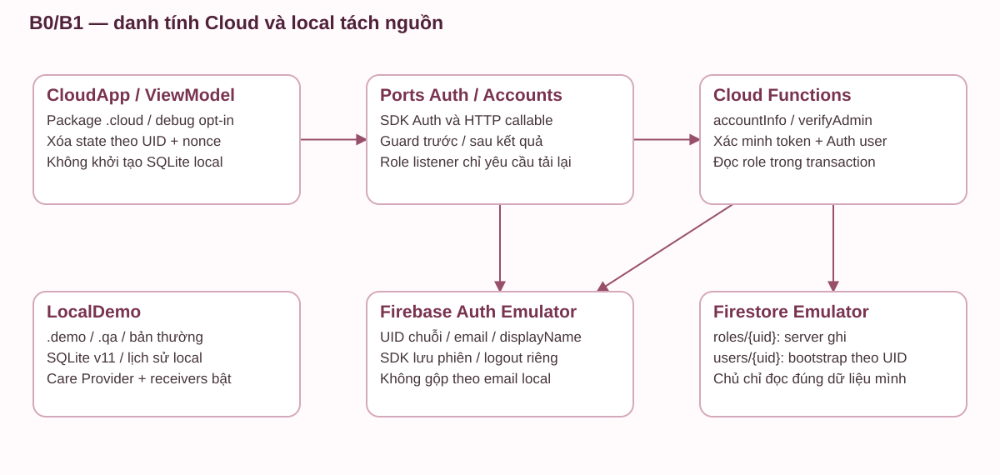

Phạm vi này chạy Auth/Firestore/Functions Emulator cùng project demo trên máy tính và Pixel_6; chưa có giao dịch đơn/kho/coupon server, đồng bộ sáu tính năng hoặc triển khai backend live. [Hướng dẫn và hợp đồng](../firebase-auth-emulator.md).

## 6. Giao diện và minh chứng

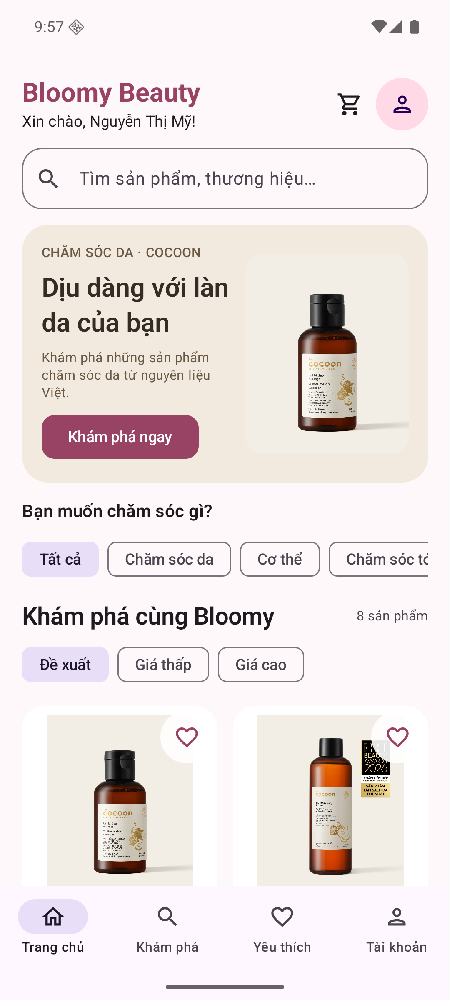

Hình 1. Danh mục, tìm kiếm, nhóm sản phẩm và điều hướng tài khoản.

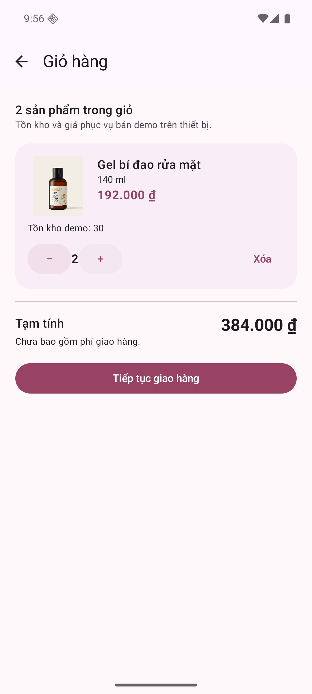

Hình 2. Giỏ hàng theo tài khoản, số lượng và tiền nguyên VND.

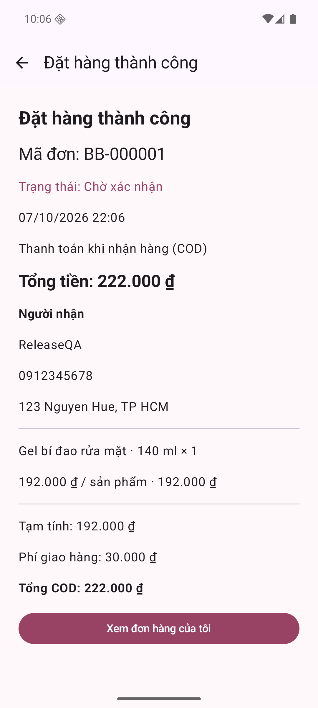

Hình 3. Đơn COD BB-000001 khôi phục sau force-stop APK release QA.

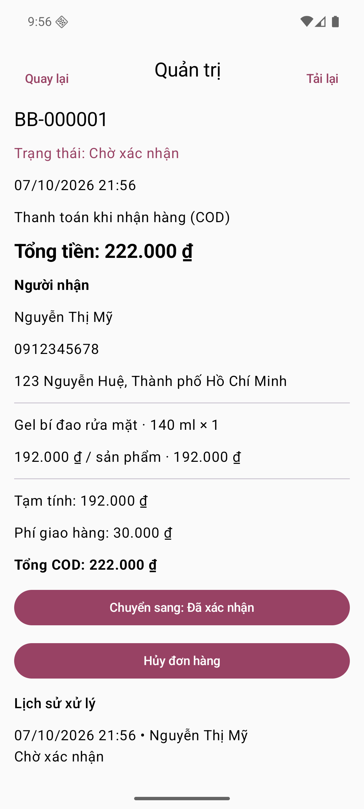

Hình 4. Quản trị xử lý trạng thái và lịch sử. Đây là ảnh nghiệm thu debug; release QA không có admin tự tạo.

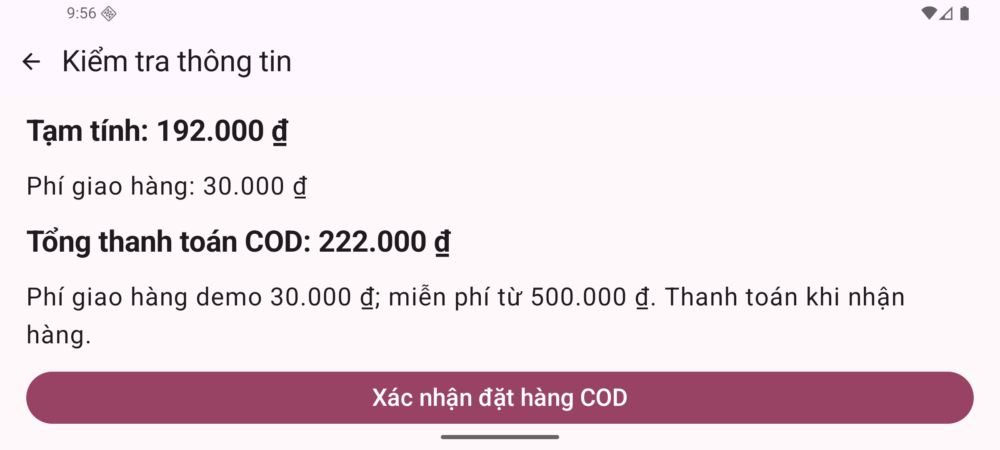

Hình 5. Activity ngang và chữ Compose 150%; có thể cuộn tới hành động xác nhận/kết quả.

## 7. Kết quả kiểm thử

Ngày 07/10/2026: 24 JVM + 81 Android = **105 ca đạt**, không bỏ qua, trên Pixel 6/API 36. Build/lint debug và release thành công. Lint debug 45 warning + 1 information; release 23 warning + 1 information; 0 error. Ma trận 24 dòng và các ca đạt/một phần/chưa áp dụng ghi ở [kế hoạch, mục 23.4](../ke-hoach-de-tai.md#234-kết-quả-nghiệm-thu).

Các nhóm chính: validation/hash/truy vấn tham số; đổi phiên/truy cập chéo; tìm/lọc/yêu thích; giỏ/địa chỉ; giá/tồn đổi; rollback lỗi giữa nhiều dòng; 8 retry đồng thời; fingerprint sai; hủy lặp/race; snapshot/revision/audit; migration; tiếng Việt; điều hướng/tái tạo; cold start/new ViewModel; ngang/chữ lớn.

Release QA được cài riêng và thao tác ngoài instrumentation: đăng ký → giỏ 1 sản phẩm → force-stop/mở lại giữ phiên/giỏ → lưu giao hàng → force-stop khôi phục review → đặt BB-000001 tổng 222.000 ₫ → force-stop khôi phục thành công → lịch sử 1 đơn/tồn 29. Ca nhiều khách tồn 1 hiện theo phiên lần lượt trên cùng thiết bị; không coi là kiểm thử hai thiết bị đồng thời.

APK `.demo` của Phase 13 thêm package/config debug riêng để bàn giao tài khoản công khai; không thay nghiệp vụ. Kết quả diễn tập trực tiếp của APK này được cập nhật trong kế hoạch mục 24. Không gọi 105 ca là connected tests chạy trên APK `.demo` nếu chúng chạy trên gói debug gốc.

### 7.1. Kiểm thử bổ sung trên Pixel 6 ngày 07/11/2026

Theo yêu cầu, đợt này chỉ sử dụng AVD **Pixel_6 do người dùng mở**, Android 16/API 36. Không tạo hoặc khởi động thêm AVD. Cài đè gói `.demo` và APK instrumentation bằng ADB; không chạy Gradle connected test có bước gỡ app. Dữ liệu gói chính `com.example.bloomybeauty` không bị xóa.

Nhóm F1–F3: **12 ca đạt, 1 ca bỏ qua theo điều kiện, 0 lỗi** trong 13 ca. Ca bỏ qua cần quyền thông báo được thu hồi trước instrumentation. Bao phủ Provider CRUD/MIME/URI/revision/quyền sở hữu, observer, migration giữ dữ liệu, nhắc lặp/hai lịch cùng giờ, receiver và notification, đăng xuất hủy nhắc, broadcast sau commit/rollback/retry, CRUD giao diện và khôi phục bản nháp.

Bộ hồi quy toàn app chạy lại trên gói demo sau sửa fixture: **98 ca đạt, 7 bỏ qua theo điều kiện, 0 lỗi** trong 105 ca. JVM trên máy build: **46/46 đạt**; lint **0 lỗi, 38 cảnh báo, 1 thông tin**. Lần đầu có ba lỗi kiểm thử do cố định package/IME và kỳ vọng FCM ở biến thể tắt Firebase; đã sửa kiểm thử và chạy lại toàn bộ. Log từng lần được giữ để đối chiếu, không gộp số ca giữa các lần chạy.

Ảnh chụp từ giao diện Compose chạy thật trên Pixel_6; tài khoản kiểm thử tạm được dọn sau ca kiểm thử. Ảnh chụp tại các mốc kiểm thử không thay thế kiểm tra giao alarm của hệ điều hành. Minh chứng và log: [Kiểm thử Pixel 6](../kiem-thu/pixel6-care-2026-11-07/README.md).

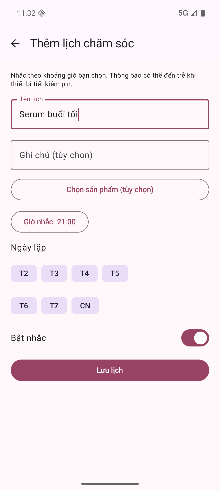

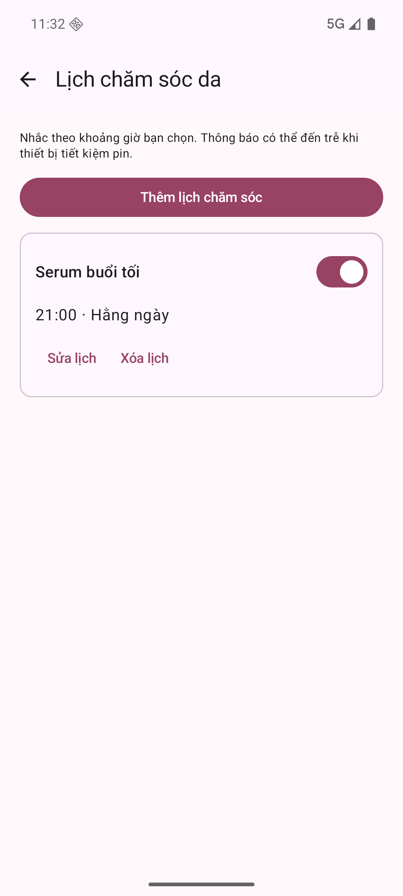

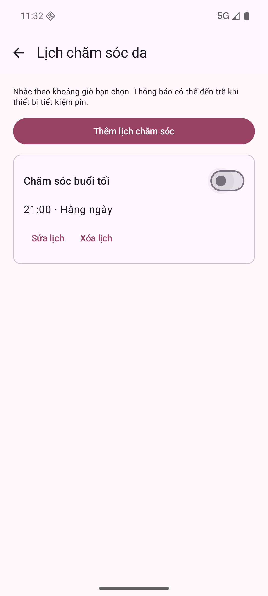

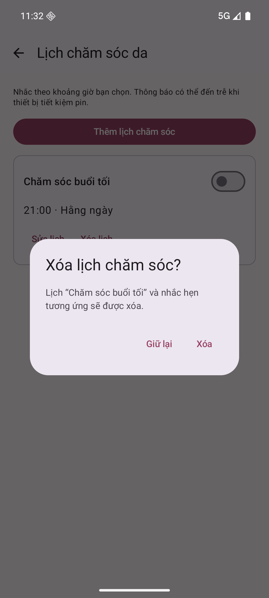

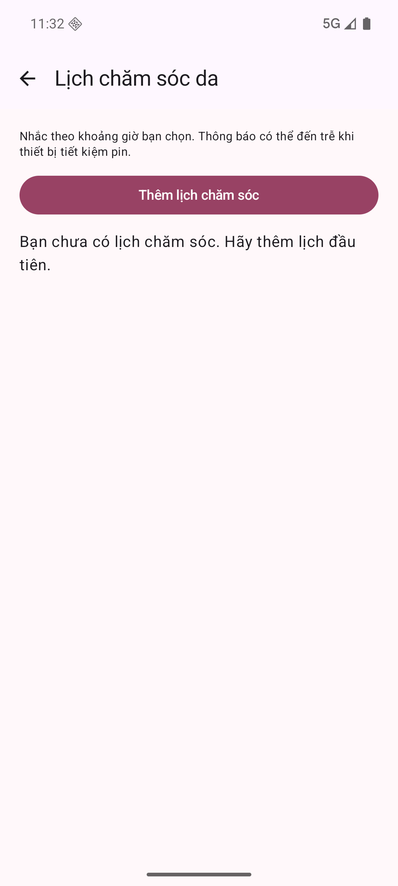

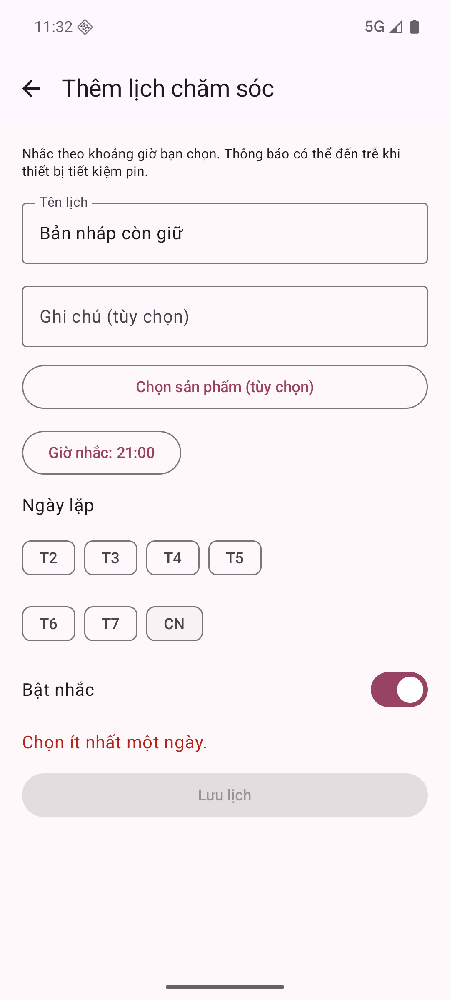

### 7.2. Mở rộng schema 11, ngày 08/11/2026

Hồi quy local trên đúng Pixel_6: 172 ca, 164 đạt và 8 assumption skip, 0 lỗi; lượt denied riêng 4/4 và khôi phục quyền; JVM 62/62, lint 0 lỗi/43 cảnh báo/1 thông tin. Có ảnh dashboard, phiếu PDF native mở bằng reader bên ngoài, inbox và navigation tích hợp. Phiếu dài 100 sản phẩm có 8 trang; đã đối chiếu văn bản tiếng Việt, dòng cuối và tổng tiền.

[Xem log, nguồn ảnh, manifest và giải thích các lượt chưa đạt](../kiem-thu/pixel6-commerce-integration-2026-11-08/README.md). Đây là nghiệm thu SQLite một thiết bị, không phải chứng nhận đồng bộ Firebase hoặc kiểm tra điện thoại thật. Báo cáo tiến độ Word lần 2 là mốc lịch sử trước mở rộng và không bị sửa số liệu cũ.

### 7.3. Nghiệm thu danh tính Cloud trên Emulator, 08/11/2026

Backend danh tính/quyền 7/7, rules ưu đãi cũ 9/9; kiểm thử Pixel_6 cho đăng ký/đăng nhập tiếng Việt, cùng email không kế thừa tài khoản/đơn local, đổi UID, grant/revoke ADMIN với cùng ID token và cold start qua force-stop thật. Hồi quy local 48/48 và JVM 62/62. [Số ca cuối cùng, ảnh đã xem, log và manifest](../kiem-thu/pixel6-cloud-identity-2026-11-08/README.md).

Đã sửa receiver khôi phục lịch còn khởi tạo database local trong Cloud sau cài đè. Cold-start scenario kiểm tra Provider/receivers local bị tắt và không tạo database local. Việc này không thay dữ liệu hoặc khả năng nhắc lịch của bản local.

## 8. Hạn chế và hướng phát triển

Min SDK là 28; đợt nghiệm thu mở rộng này chạy trên Pixel_6 API 36. Thiết bị thật để nghiệm thu sau theo yêu cầu. APK trình diễn ký debug, release thường chưa có khóa ký chính thức. Thông tin thành viên/lớp/giảng viên, phân công và ngày bảo vệ còn chờ điền.

SQLite một thiết bị không cung cấp danh tính/ủy quyền tin cậy cho cửa hàng nhiều thiết bị. Bảo vệ Repository không chống root/sửa database trực tiếp. Đơn hàng chưa có backend và đồng bộ kho, online payment, remote image upload. Đã có đánh giá cục bộ cho đơn đã giao. Đã có nhắc chăm sóc cục bộ, broadcast thay đổi đơn và nhận FCM; chưa có backend gửi FCM tự động theo trạng thái đơn. Giá tham khảo không cập nhật theo cửa hàng; tồn và mọi đơn là dữ liệu demo.

Các hướng mở rộng sau môn học (không phải hạng mục còn thiếu của demo): backend có xác thực và quyền server; giao dịch/khóa chống trùng phía server; đồng bộ thay đổi kho; kiểm thử mất phản hồi mạng; cổng thanh toán sandbox; ảnh có kiểm tra quyền; kiểm thử thiết bị Android tối thiểu và kiểm thử backup thực tế. Không dùng các phần dự kiến này để mô tả chức năng đã có.

## 9. Kết luận

Phạm vi demo môn học đã hoàn thành ở bản local A0–A7. Không cần xây dựng hoặc triển khai BE để nghiệm thu; phần Cloud/Auth đã thử được giữ làm tài liệu tham khảo.

Đồ án đã triển khai luồng khách–quản trị trên Android với SQLite, từ xác thực đến đặt/hủy và xử lý đơn. Trọng tâm kỹ thuật là tính đúng của tiền/tồn/quyền qua transaction, dữ liệu snapshot, fingerprint và revision. Bộ kiểm thử và kịch bản cold start cung cấp bằng chứng cho phạm vi chạy trên API 36. Các bước nghiệm thu thiết bị, ký phát hành và hoàn thiện thông tin học phần cần thực hiện trước khi nộp chính thức.

## 10. Tài liệu tham khảo

- [Android: lưu trữ với SQLite](https://developer.android.com/training/data-storage/sqlite).
- [Android Auto Backup](https://developer.android.com/identity/data/autobackup).
- [Android: build bằng dòng lệnh](https://developer.android.com/build/building-cmdline).
- [Nguồn sản phẩm/ảnh Cocoon theo từng trang](../product-sources.md), thu thập 07/10/2026.
- Mã nguồn trong `app/src/main/`, các fixture trong `app/src/androidTest/` và `app/src/test/` của bản bàn giao.

## Phụ lục A. Phân công thực tế

| Thành viên/MSSV | Phần việc đã thực hiện | Bằng chứng file/commit/biên bản | Người xác nhận |
|---|---|---|---|
| [Điền] | [Điền đóng góp thực tế] | [Điền] | [Điền] |
| [Điền nếu có] | [Điền đóng góp thực tế] | [Điền] | [Điền] |

Không quy các phần được hỗ trợ tự động cho một thành viên nếu chưa xác nhận. Workspace hiện không có repository Git; manifest SHA-256 xác định tập file bàn giao, không thay thế lịch sử đóng góp.
