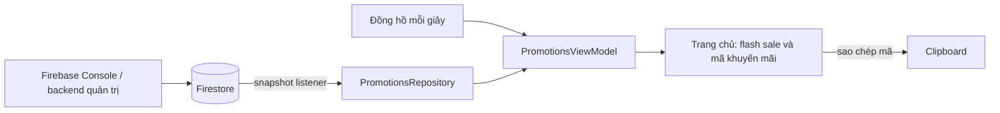

# Firestore realtime: flash sale và phát mã khuyến mãi

Ứng dụng kết nối project `bloomy-beauty`, database `(default)` bằng cấu hình
`app/google-services.json`. Không dùng URL Firebase Console làm endpoint SDK.
Document có sẵn `bloomy-beauty/PDSC8GuM5xpfLOuQgw0s` được giữ nguyên.

Phạm vi hiện tại là **công bố chương trình realtime trên trang chủ**: xem flash sale,
đếm ngược, xem/sao chép mã đã phát hành. Giá và tổng đơn trong SQLite vẫn giữ cơ chế
hiện có; chưa nhận mã giới hạn lượt, trừ quota hoặc áp dụng giảm giá khi đặt hàng.
Giao diện ghi rõ điều này để tránh nhầm giá thanh toán.

## Luồng dữ liệu



- `FirestorePromotionsRepository`: hai listener truy vấn `published == true`, không
  cần composite index. `MetadataChanges.INCLUDE` cập nhật cả trạng thái cache.
- `PromotionsViewModel`: kết hợp dữ liệu với đồng hồ; không truy vấn Firestore mỗi
  giây. `startsAt <= now < endsAt` là đang chạy; đúng `endsAt` thì hết hạn.
- Flash sale sắp bắt đầu có đếm ngược; mã chỉ xuất hiện trong thời gian phát hành.
- `collectAsStateWithLifecycle` và `SharingStarted.WhileSubscribed(0)` dừng listener
  khi không có UI theo dõi, khi app vào nền hoặc khi đăng xuất. Hủy Flow gọi
  `ListenerRegistration.remove()`. Vào lại trang chủ sẽ kết nối lại.
- Mất mạng: hiển thị nhãn dữ liệu đã lưu và khóa sao chép mã. Có mạng lại: SDK
  tự đồng bộ. Lỗi listener/quyền: xóa ưu đãi của collection bị lỗi, báo trạng thái
  và có nút tải lại để tạo listener mới. Catalog và giỏ hàng vẫn hoạt động.
- Document sai schema bị bỏ qua riêng lẻ. Các chương trình khác vẫn hiển thị.
- Flash sale chỉ hiện khi `productId` còn bán trong catalog và giá thấp hơn giá gốc.
- Bản `.demo` và `.qa` dùng `DisabledPromotionsRepository`, không kết nối Firestore.

## Schema

Tạo **collection ở gốc database**, không lồng bên trong document `bloomy-beauty/...`.
Các trường tiền dùng **number nguyên** theo VND; thời gian dùng **timestamp**, không
phải string. Không nhập giá dạng `149000.5` hoặc chuỗi `"149000"`.

### `flash_sales/{saleId}`

Mỗi document là một sản phẩm trong một đợt sale; nhiều sản phẩm dùng nhiều document.

| Trường | Kiểu | Ví dụ / ý nghĩa |
|---|---|---|
| `published` | boolean | `true` để công bố, `false` để ẩn ngay |
| `title` | string | `Giờ vàng Bloomy` (1–120 ký tự) |
| `productId` | string | `cleanser` |
| `salePriceVnd` | integer | `149000`, lớn hơn 0, nhỏ hơn giá catalog |
| `startsAt` | timestamp | Giờ bắt đầu |
| `endsAt` | timestamp | Giờ kết thúc, phải sau giờ bắt đầu |

ID sản phẩm hiện có: `cleanser`, `micellar`, `serum`, `toner`, `body_scrub`,
`shampoo`, `lip_scrub`, `lip_balm`.

### `coupon_campaigns/{campaignId}`

Mỗi document là một đợt phát **mã dùng chung công khai**, không phải mã cá nhân.

| Trường | Kiểu | Ví dụ / ý nghĩa |
|---|---|---|
| `published` | boolean | `true` để phát hành |
| `title` | string | `Ưu đãi chào mừng` |
| `code` | string | `BLOOMY20`, 3–32 ký tự `[A-Z0-9_-]` |
| `discountType` | string | `percent` hoặc `fixed` |
| `discountValue` | integer | `20` cho 20%; `30000` cho giảm 30.000đ |
| `minOrderVnd` | integer | `200000`, cho phép 0 |
| `maxDiscountVnd` | integer | `50000`; bắt buộc với `percent`, tùy chọn với `fixed` |
| `startsAt` | timestamp | Bắt đầu hiện mã |
| `endsAt` | timestamp | Hết hạn và tự ẩn mã |

Giảm phần trăm phải trong 1–100; các số tiền tối đa 1.000.000.000đ. Khi có mã cố
định, `maxDiscountVnd` nên bỏ trống; mức giảm là `discountValue`.

## Cấu hình trên Firebase Console

1. Mở Firestore của project `bloomy-beauty`, database mặc định.
2. Thêm collection `flash_sales`, document `cleanser-launch`; nhập các trường
   ở bảng trên. Chọn `startsAt` trước giờ hiện tại và `endsAt` sau giờ hiện tại
   để xem ngay. Giữ `published = false` trong khi soạn rồi chuyển sang `true`.
3. Thêm `coupon_campaigns/welcome`, nhập schema và mã `BLOOMY20` tương tự.
4. Cài bản debug gốc, đăng nhập và vào trang chủ. Sửa `title` hoặc giá trong
   Console để kiểm tra cập nhật trực tiếp. Chuyển `published` sang `false` hoặc
   xóa document để gỡ chương trình ngay.
5. Trong tab Rules, rà soát rồi Publish nội dung [firestore.rules](../firestore.rules).
   File này chỉ công khai đọc chương trình `published`; chặn mọi ghi từ client và
   chặn các collection khác. Nó thay thế rules hiện tại, nên cần gộp quy tắc riêng
   nếu project có thêm chức năng khác. Tài khoản quản trị Console/Admin SDK vẫn
   quản lý dữ liệu bằng IAM.

Rules chưa được triển khai tự động lên project thật. Các thử nghiệm ghi dữ liệu
và kiểm thử rules chỉ chạy trên project giả lập `demo-bloomy-beauty`.
Không giữ rules test mode mở toàn bộ database khi dùng dữ liệu thật.

Các document `published = true` là dữ liệu công khai, kể cả nếu `startsAt` chưa tới.
Ẩn mã trên UI trước giờ **không phải bảo mật**: nếu cần giữ bí mật mã trước giờ phát,
giữ `published = false`, rồi bật đúng giờ bằng Console hoặc backend chạy lịch.
Không lưu thông tin khách hàng, mã cá nhân hay khóa gửi FCM trong các document này.

Truy vấn chỉ lấy `published`; nên chuyển các chiến dịch cũ sang `false` để tránh
đọc lại lịch sử không cần thiết. Với lượng chiến dịch lớn, tách active feed có giới
hạn và phân trang lịch sử. Không sửa schema hoặc đổi listener sang đọc toàn collection
vì rules yêu cầu `published == true`.

## Thiết kế cho nhận mã giới hạn lượt và áp dụng vào đơn

Giai đoạn tiếp theo cần một backend đáng tin cậy, không thể dùng tài khoản SQLite
hoặc vai trò admin cục bộ làm danh tính Firestore:

1. Liên kết người dùng với Firebase Authentication; backend dùng UID đã xác thực.
2. Client gọi API `claimCoupon(campaignId, requestId)`; backend kiểm tra giờ máy chủ,
   điều kiện, quota và giới hạn mỗi UID trong transaction. Lưu claim riêng tại
   `coupon_campaigns/{id}/claims/{uid}` và trả kết quả idempotent cho yêu cầu lặp.
3. Client gọi checkout online; backend đọc giá/flash-sale stock chính thức, xác
   thực claim, tính giảm giá và trừ quota/tồn trong transaction. Không tin giá,
   đồng hồ hoặc tổng tiền do client gửi. Đơn SQLite hiện tại không đủ để đảm bảo
   quota và tồn kho trên nhiều thiết bị.
4. Backend có thể phát FCM khi công bố chương trình. Listener chỉ cập nhật khi
   app đang theo dõi; nó không tự gửi thông báo đẩy khi app đóng.

## Kiểm thử

JDK 17+ cho Gradle, Node 20+ cho bộ rules. Khi chạy emulator, đưa thư mục `bin` của
JDK 21 vào `PATH` (chỉ đặt `JAVA_HOME` có thể chưa đủ với Firebase CLI).

```sh
./gradlew :app:assembleDebug :app:testDebugUnitTest :app:lintDebug
npm --prefix firebase-tests ci
npm --prefix firebase-tests test
```

Rules tests chạy Emulator Suite và không dùng project thật. Có 9 ca cho đọc công
khai, chặn bản nháp, chặn truy vấn không lọc và chặn ghi từ mọi client.

Để kiểm thử listener Android, mở Firestore Emulator trong terminal riêng:

```sh
npm --prefix firebase-tests run emulator
```

Sau đó chạy trên **Android Emulator** (host máy tính là `10.0.2.2`):

```sh
./gradlew :app:connectedDebugAndroidTest \
  -Pandroid.testInstrumentationRunnerArguments.class=com.example.bloomybeauty.data.promotions.FirestorePromotionsTest,com.example.bloomybeauty.feature.promotions.PromotionsSectionTest \
  -Pandroid.testInstrumentationRunnerArguments.firestoreEmulator=true
```

Ba ca repository kiểm tra tạo/sửa/ẩn/xóa chương trình, bỏ qua document lỗi và
cache/kết nối lại. Hai ca Compose kiểm tra thay đổi realtime, tự hết hạn và trạng
thái cache/lỗi. Fixture chỉ ghi vào `demo-bloomy-beauty` trên emulator; không chạy
rules tests và Android emulator tests đồng thời vì cùng dùng fixture database.

Kiểm tra kết nối project thật **chỉ đọc**, cần mạng và rules cho phép:

```sh
./gradlew :app:connectedDebugAndroidTest \
  -Pandroid.testInstrumentationRunnerArguments.class=com.example.bloomybeauty.data.promotions.FirestoreConnectionTest \
  -Pandroid.testInstrumentationRunnerArguments.firestoreLive=true
```

Các bài kiểm tra remote/emulator được bỏ qua trong lần chạy mặc định nếu chưa bật
cờ tương ứng. Gradle có thể cài/gỡ app khi chạy connected tests; dùng thiết bị thử.

Tham khảo: [Snapshot listeners](https://firebase.google.com/docs/firestore/query-data/listen),
[Rules và truy vấn](https://firebase.google.com/docs/firestore/security/rules-query).
